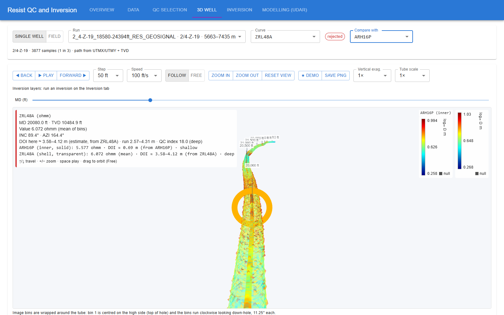
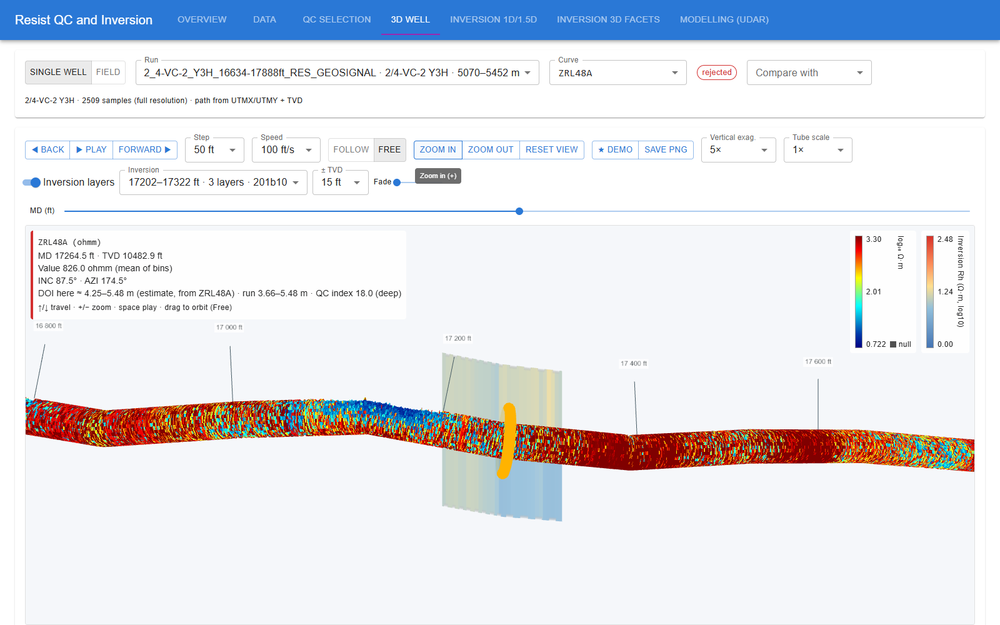

# resist

Resistivity QC and inversion platform for the Ekofisk well data.

- **Backend:** Python, FastAPI (`backend/`). Health, run list, curve inventory, curve data, QC selection and 3D well path endpoints on the real Ekofisk data.
- **Frontend:** JavaScript, Vite, React, Material UI (`frontend/`). Pages: Overview (backend health, runs), Data (curve inventory and curves vs depth), QC selection (ranked table, DOI-noise scatter, depth tracks, saved selections), 3D well (one curve along the real well path with a DOI-sized tube, compare, inversion layers, field view, demo and PNG export; see [3D well tab](#3d-well-tab)), and Modelling (UDAR), which runs the UDAR_Bench 1D forward model and inversion in the browser.
- **Data:** Ekofisk DLIS files in `data/`, with the reference notebook `view_resistivity_data_ekofisk.ipynb`.
- **UDAR_Bench:** David's standalone browser example for 1D and 2.5D forward modeling and inversion (`UDAR_Bench/`). The single-file `UDAR_Bench.html` is not in the repo; build it with `node build/build.js` in `UDAR_Bench/source/` and open `UDAR_Bench/source/build/udar.html` in Chrome. The frontend uses an unchanged copy of its compute core (`frontend/src/compute/udar/`).

## Quick start

Follow [SETUP.md](SETUP.md) for Mac and Windows commands. In short:

1. Create the root `.venv`, install `backend/requirements.txt`, then start the backend from the repo root: `python -m backend.app` (port 5000).
2. Start the frontend in a second terminal: `cd frontend` then `npm install` and `npm run dev` (port 5173).
3. Open http://localhost:5173. The Overview page shows the backend status and the run count.

## Data analysis

The [Ekofisk analysis CLI](docs/data/ekofisk-format.md) inventories all ten wells
(eleven runs), plots measurements, and flags sustained transition candidates.
Geological labels remain unknown until calibrated interpretation rules are supplied.

## Inversion strategy

We have completed a research study on optimal 1.5D EM inversion approaches for the ADR tool on Ekofisk data.
Key findings:

- **1D layered VTI forward model** (at real tool position on well trajectory) is **exact for planar beds** at oblique tool angles.
- **Efficiency:** 1D costs milliseconds per station; 2D/2.5D costs minutes per run.
- **Harmonic reduction:** Extract mean, amplitude, and phase from 32-bin azimuthal images; reduces data 32:3 while preserving physics.
- **Windowed Levenberg-Marquardt inversion** with 50% overlap and continuity regularization: full 11-run inversion in 1–8 hours on a laptop.
- **Dip accommodation:** Use wellbore trajectory to rotate stratigraphy into tool frame; dip emerges naturally.

See [docs/inversion/RESEARCH_SUMMARY.md](docs/inversion/RESEARCH_SUMMARY.md) for high-level overview and [docs/inversion/HACKATHON_PLAN.md](docs/inversion/HACKATHON_PLAN.md) for the implemented 1.5D inversion, the Z-20 misfit study and correction factors, and the 2-day hackathon schedule.

Run the misfit study: `python -m backend.inversion.misfit_study --well Z-20 --md-min 20100 --md-max 20500 --output out/z20`.

In the app, the **Inversion** tab inverts the curves chosen on the **QC selection** tab (button *Invert this selection →*) and shows the layered model, a curtain section, and measured vs modelled logs.

**Run on Local / Server.** Next to *Run inversion*, pick where it computes: *Local* (this backend) or *Server (72 cores)*, the inversion server (the same backend on an Azure F72s v2 VM, port 8000). Set its URL with `RESIST_INVERSION_SERVER_URL=http://<vm>:8000` or in `backend/inversion_server.json` (`{"url": "http://<vm>:8000"}`), then restart the backend. *Server* is disabled, with the reason in its tooltip, when no URL is set or `GET <url>/health` fails. Stored results are still returned instantly; otherwise the local backend forwards the job, mirrors its progress and saves the finished result locally too. See `GET /inversion/targets` in [docs/api/contract.md](docs/api/contract.md).

## 3D well tab

The **3D well** tab draws one QC curve along the real well path (UTMX/UTMY + TVD), in the QC tab's colours. The tube radius is a per-sample depth of investigation (DOI) estimate: skin depth `503·√(ρ/f)`, softly capped at 3 transmitter–receiver spacings. For 32-bin images the ring bulges toward the resistive (red) bins; ZG geosignals take that shape from the matching ZR image. Open it with **3D** on a QC row, a selection chip, or `?tab=3d&run=<run>&curve=<curve>`.

| Control | What it does |
|---------|--------------|
| **Back / Play / Forward**, MD slider, **Follow / Free** | Travel along the well; Follow keeps the camera behind the travel point |
| **Compare with** | Adds a second curve: the shallower one is the solid inner tube, the deeper one a transparent shell, each with its own colour bar |
| **Inversion layers** | Shows only the inversion result of the newest finished job from the **Inversion** tab (picker to switch): a vertical curtain hanging along the well over the inverted MD interval, coloured by inverted Rh vs TVD with the Inversion tab's curtain colour scale (1–300 Ω·m, log10; own colour bar). **± TVD** sets the curtain height, **Fade** hides the most uncertain cells first |
| **Single well / Field** | Field draws all 11 runs at their UTM positions; hover highlights a well, a click opens it |
| **★ Demo** | Scripted fly-through with captions at the most resistive and most conductive zone, the largest DOI spread (image curves) and TD; **Stop demo** or Escape ends it |
| **Save PNG** | Downloads `<run>_<curve>_<md>ft.png` of the 3D canvas; `window.__well3dSnapshot()` returns the same image as a data URL |

Inversion jobs live in backend memory, so run an inversion after each backend restart before turning on the layers. The DOI is an estimate, not a vendor figure; see [docs/plans/well-3d-view.md](docs/plans/well-3d-view.md) for the assumptions.

## Documentation

- [SETUP.md](SETUP.md): developer setup and run commands.
- [docs/api/contract.md](docs/api/contract.md): curve table, QC JSON, and endpoints.
- [docs/data/ekofisk-format.md](docs/data/ekofisk-format.md): Ekofisk data format and analysis CLI.
- [docs/plans/resist-platform-dev-plan.md](docs/plans/resist-platform-dev-plan.md): work plan and workstream owners.
- [docs/inversion/ADR_1D5_strategy.md](docs/inversion/ADR_1D5_strategy.md): detailed forward model, inversion, and validation strategy.
- [docs/inversion/IMPLEMENTATION_PLAN.md](docs/inversion/IMPLEMENTATION_PLAN.md): 6-week implementation roadmap with 5 workstreams.
- [docs/inversion/RESEARCH_SUMMARY.md](docs/inversion/RESEARCH_SUMMARY.md): executive summary of inversion research findings.
- [presentations/hackathon](presentations/hackathon/README.md): Slidev deck for the 4-minute hackathon demo.
- [competitor UDAR inversion background](background/competitor-udar-inversion.md): summary of a related SPWLA paper and its relationship to the Ekofisk data release.
