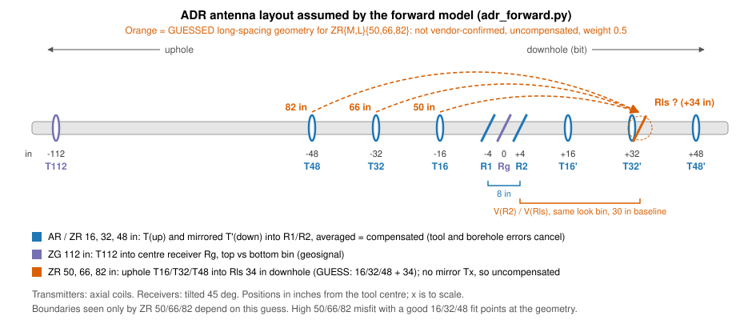

# ADR 1.5D Inversion Strategy for the Resist Platform

> **Hackathon adjustment (Nov 2026).** The forward model and windowed LM approach below are implemented in
> `backend/inversion/`. A misfit study on Z-20 (20100–20500 ft MD) shows that the theory does **not** fit every curve
> equally. Phase resistivities agree within a few percent. 2 MHz attenuation reads 15–45% high, and the error grows
> with resistivity. 500 kHz and 125 kHz attenuation show no stable correction. The algorithm therefore inverts phase
> as primary data, applies a resistivity-dependent correction to 2 MHz attenuation, and uses low-frequency attenuation
> for QC only. See [HACKATHON_PLAN.md](HACKATHON_PLAN.md) for the numbers, the correction table, and the 2-day schedule.

## Executive Summary

For efficient 1.5D EM inversion of the Halliburton ADR tool on Ekofisk data:

- **Forward model:** 1D layered VTI (Rh/Rv) evaluated with point-dipole sources at the real tool position and orientation along the trajectory
- **Inversion method:** Gradient-based (Levenberg-Marquardt or Gauss-Newton) on sliding windows (~60 ft, 50% overlap)
- **Data reduction:** Fit first-harmonic sinusoids to 32-bin azimuthal images; extract mean, amplitude and phase
- **Dip accommodation:** Parameterize bed-normal orientation in tool frame; rotate via trajectory inclination/azimuth
- **Expected cost:** ~1–10 seconds per window; full run in 1 hour on a workstation
- **Near-real-time:** Feasible with warm starts (rolling inversion during acquisition)

---

## Detailed Recommendations

### 1. Forward Model: 1D Layered VTI

**Why 1D?**
- Exact solution for planar beds at oblique tool positions (the 1.5D case)
- Runs at milliseconds per station with Hankel digital filters
- 2D/2.5D costs 10+ minutes per run; 3D is impractical for 11 runs

**Parameterization:**
- Layer stack with K = 3 to 5 layers (target, pay zone, shale, seal)
- Per-layer horizontal (Rh) and vertical (Rv) resistivities (VTI)
- Boundaries: TVD depth at window centre, plus dip and dip azimuth (shared or independent per boundary)

**Trajectory integration (1.5D):**
- Use wellbore trajectory (TVD, inclination, azimuth) at each station
- Rotate stratigraphy into tool frame via `makeStation`, `dipNormal` transforms
- Dip and dip azimuth automatically adjust as the well deviates

**Compensation:**
- Apply ADR patent formulas to modeled phase and attenuation (p.3, dossier)
- Convert attenuations to dB (× 8.686)
- Handle unknown borehole corrections via nuisance gains per channel

**Bin modeling:**
- 32 bin voltages: `V_k = cos(θ)·Hzz + sin(θ)·(Hxz·cos(ψ_k) + Hyz·sin(ψ_k))`
- ψ_k = (k-1) × 11.25° with unconfirmed bin-zero orientation (treat as a nuisance offset)
- Fit first harmonic only (3 DOF: mean, cosine amp, sine amp)

### 2. Data Reduction: Harmonic Fitting

**Why harmonic extraction?**
- 32 azimuthal samples per depth encode only ~3 degrees of freedom for a 45° tilted receiver
- Fit reduces data, removes noise, and aligns with tool physics

**Procedure per frequency/spacing:**
1. For each depth and each receiver configuration (compensated pair or R3):
   - Fit `a₀ + a₁·cos(ψ) + b₁·sin(ψ)` to the 32 bin phase and attenuation
   - Extract mean (a₀), amplitude √(a₁² + b₁²), and phase atan2(b₁, a₁)
   - Reserve residual of harmonics 2+ as noise QC

2. Use mean, amplitude, and phase as inversion data
3. Geosignals (bin k minus bin k+16) are, up to a factor, the first-harmonic amplitude itself

**Quality gate:**
- Keep readings only when opposite-bin difference is <few percent of the reading (US 9,239,403, dossier p.6)

### 3. Inversion: Windowed Levenberg-Marquardt

**Window design:**
- N stations per window (~30–60 ft MD, 60–120 samples at 0.5 ft)
- Overlap windows by 50% and slide along the MD track
- Shared layer-stack parameterization within each window
- Tie overlapping windows with a continuity/smoothness prior on boundary positions

**Optimization:**
- Gradient: Levenberg-Marquardt with finite-difference Jacobians (2P+1 forward calls per iteration)
- Damped trust region to stabilize near local minima
- Convergence: typically 5–15 iterations
- Multi-start initialization:
  - Use a pre-computed library of sinusoid mean/amplitude vs. boundary distance and contrast
  - Run 5–10 independent trials with different initializations
  - Report the best-fit model and uncertainty metrics (posterior variance from Hessian)

**Parameters per window:**
- 3K resistivities (Rh and Rv per layer)
- 2 boundary positions (top and bottom, relative to window centre)
- 2 boundary dip parameters (shared or independent)
- Optional: 1–2 nuisance gains/offsets per channel or frequency

**Regularization:**
- Smoothness on boundary positions along MD (Tikhonov L2)
- Continuity ties to adjacent windows (penalty on depth jumps at overlap)
- Damping on resistivity changes within thick intervals

### 4. Validation

**Non-circular checks with conventional logs:**
- Use GR, density, and core data as qualitative context only
- Inversion is not constrained by logs; use inversion results to explain log variations
- Compare inverted resistivity ranges to core sample measurements (if available)
- Cross-plot inverted Rh/Rv against expected anisotropy from core fabric

**Round-trip synthetic tests:**
- Use the UDAR_Bench repository's forward engine
- Create synthetic resistivity models (known dip, known Rh/Rv)
- Compute synthetic ADR responses with the bench
- Invert the synthetic data
- Measure misfit and parameter recovery

**Spot validation with 2D/2.5D:**
- For select intervals (e.g., near boundaries), run a 2D FD forward model
- Compare 1D and 2D predictions
- If 1D misfit is large and 2D improves it significantly, flag as potential 3D/multi-dip zone

### 5. Computational Strategy

**Per-window cost:**
- One 1D forward evaluation: ~0.2–2 seconds (Hankel digital filters over all S/F pairs)
- Finite-difference Jacobian: ~21 forward calls = 4–40 seconds
- 10 iterations: ~40–400 seconds per iteration
- Total per window: ~1–10 seconds (best case with batching and caching)

**Full-run throughput:**
- 11 runs × 5,000–15,000 ft MD ≈ 1,000–3,000 windows (at 50% overlap)
- Single-threaded: 1,000–30,000 seconds ≈ 15 min to 8.3 hours
- Multi-threaded (8 cores): 2–60 minutes

**Near-real-time rolling inversion (during acquisition):**
- As each new station is drilled (every few feet MD):
  - Add it to the sliding window
  - Warm-start LM from the previous window's solution
  - Invert and report results within seconds
  - Discard the oldest station and repeat

### 6. Handling Unconfirmed Tool Parameters

**Bin zero and rotation direction:**
- Treat as global nuisance parameters: ψ₀ (bin zero offset) and s = ±1 (rotation sign)
- Estimate on a thick, well-defined boundary or homogeneous zone
- Once estimated, hold constant or re-estimate periodically

**Transmitter-receiver frequency mapping:**
- The dossier states that the breakdown of which pair runs at which frequency is not published (p.6)
- For now, assume all frequencies are present for all spacings (conservative)
- Adjust when Halliburton clarifies

**Long-spacing ZR 50/66/82 in geometry (guessed):**

- The antenna layout for `ZR{M,L}{50,66,82}` is not confirmed. The forward model assumes that the uphole 16/32/48 in transmitters fire into a third tilted receiver 34 in downhole of the tool centre (`LS_RECEIVER_IN` in `backend/inversion/adr_forward.py`), so 50/66/82 = 16/32/48 + 34.
- The measurement is the ratio of the near main receiver (R2, +4 in) to that receiver in the same look bin. No mirrored transmitter exists, so it is uncompensated and tool and borehole effects do not cancel.
- These channels get half weight (`GUESSED_GEOMETRY_WEIGHT = 0.5` in `backend/inversion/service.py`). Check their misfit separately: high misfit on 50/66/82 alongside a good 16/32/48 fit points at the geometry, not the earth model. Treat boundaries that only these channels resolve with caution.
- Open question 2 in [ADR_2D5_3D_plan.md](ADR_2D5_3D_plan.md) asks the vendor for the real layout.

**Borehole and mandrel effects:**
- Not in the 1D model; introduce nuisance gains per channel
- Alternative: fit a simple borehole-correction term (e.g., resistivity-dependent calibration factor)
- Validate against centralized vs. eccentric runs if available

### 7. Implementation status

1. **1D forward model** – done: `backend/inversion/adr_forward.py` (empymod, TIV, dip, trajectory, compensation, whole-space transform).
2. **Harmonic fitting** – use `backend/qc/metrics.harmonics` (bin mean and first-harmonic amplitude) when adding azimuthal data.
3. **LM inversion core** – done for one window: `backend/inversion/invert.py` (trust-region LM, multi-start, per-curve weights and corrections). Windowed driver with overlap ties is next.
4. **Pipeline/API integration** – `POST /invert/run` is planned for hackathon day 1.
5. **Validation** – synthetic round trip in `backend/tests/test_inversion.py`; field misfit study in `backend/inversion/misfit_study.py`.
6. **User interface** – inversion tab is planned for hackathon day 2.

See [HACKATHON_PLAN.md](HACKATHON_PLAN.md) for owners and the schedule.

---

## References and Resources

- **UDAR_Bench:** Point-dipole 1D EM forward model and LM inversion (Halliburton-affiliated, in repo)
- **empymod:** Python 1D layered EM with anisotropy (Werthmüller, open-source)
- **SimPEG:** Geophysical inversion framework (Cockett et al., open-source)
- **ADR dossier:** Halliburton ADR tool specifics (supplied; p.5–7 on inversion approach)
- **Bittar et al., 2009:** ADR design and physics (SPE REE 12(2), DOI 10.2118/109971-PA)
- **US 9,239,403:** Quality gating and library-based distance-to-boundary (Halliburton patent)

---

## Uncertainties and Caveats

- Noise floors and accuracy figures for the ADR are not published (dossier p.7)
- Bin-zero orientation and rotation direction are unconfirmed (p.5, p.7)
- Which transmitter-receiver pairs run at which frequencies is not published (p.6)
- Borehole and mandrel corrections are unknown (not in the dossier)
- Computational cost estimates are based on assumptions and will be refined after prototyping
- The choice of K layers (3 vs. 5) will depend on the geological complexity and noise level in the Ekofisk intervals
