# ADR 2.5D → 3D Inversion Plan: Tracking Geobodies Laterally and Vertically

Status: draft v0.1 · Owner: Dylan · Builds on: [ADR_1D5_strategy.md](ADR_1D5_strategy.md) and [IMPLEMENTATION_PLAN.md](IMPLEMENTATION_PLAN.md) (David)

## Goal

Extend David's 1D/1.5D windowed inversion so the platform can map geobodies in two directions around the well:

- **Vertical** (above/below the well): bed boundaries, pinch-outs, faults crossed along the section.
- **Lateral** (left/right of the well): bodies that sit beside the well rather than above or below it.

Develop and test on **2/4-Z-20, 21,000 ft MD to the end of the run**, then generalise to other runs.

> **Interval note:** Z-20 ends at **23,791 ft MD**, so "21,000–25,000 ft" on Z-20 is 21,000–23,791 ft (2,791 ft, 5,583 samples at 0.5 ft). The 21,000–25,000 ft range matches **Z-25 run 2** (21,250–25,029 ft). This plan uses Z-20 as requested, with Z-25 run 2 as the second test.

---

## 1. What the Z-20 test interval tells us

Measured from the DLIS file (`backend.data.loader.load_run`) over 21,000–23,791 ft MD:

| Property | Value | Consequence for the plan |
|---|---|---|
| Inclination | 88.0–91.0° (median 90.1°) | Horizontal well: "vertical" in the earth is "up/down" in the tool frame |
| TVD change | 10.1 ft over 2,791 ft MD | The well tracks almost flat inside one stratigraphic package; boundaries are seen from the side, not crossed steeply |
| Azimuth | 159–174° (median 170°), drilling SSE | A 2.5D section is the vertical plane along heading ≈170° |
| Channels | 28 AR, 26 ZR 32-bin images (16–82 in), 4 ZG 32-bin images (112 in, M and L only) | Azimuthal data exist at every spacing; geosignals only at 112 in |
| Coverage | All AR/ZR/ZG channels ≥ 95 % in the window | No gap handling needed in the test interval |
| QC auto-pick (n = 8) | ZRM82P, ZGM112P, ARM16P, ZGM112A, ZRM50P, ZRL48P, ARH32AC, ZRM66P | Starting channel set; ZGL112A/P rejected as static, so the deepest clean geosignal is 500 kHz, 112 in |
| Transition events (`transitions.analyze`) | 33 measurement transitions, clustered at 21,446–21,520, 21,772–22,163, 22,292–22,312, 22,472–22,649 ft | Natural windows to test 2.5D and 3D first |
| First-harmonic direction (ZGM112P) | Dominant axis at 12° relative to bin 1 (bin zero unconfirmed); **40 %** of the strongest readings point > 30° off that axis, **14 %** > 60° | Either lateral (3D) structure, or an orientation artefact. Separating the two is the first gate (Phase 0) |
| Longest off-axis run | 22,368–22,400 ft MD | First candidate lateral geobody |
| Neighbour well | **Z-19 runs parallel** (heading ≈167°) at **81–150 m** horizontal distance across the whole window, ≈136 ft shallower in TVD | Beyond EM reach (see §2), but usable as a structural/stratigraphic tie between wells |

## 2. Physical limits we must design around

1. **Depth of investigation (DOI) is a few metres.** The dossier gives geosignal boundary detection to 18–20 ft (5–6 m) and radial mapping to about 20 ft. Lateral imaging is therefore a **corridor about ±6 m around the trajectory**, not a reservoir-scale 3D volume. "3D" in this plan means *near-wellbore 3D*: a tube around the well in which boundaries can tilt in any direction.
2. **Skin depths at Ekofisk resistivities** (RDEP 1.6–29 Ω·m, median 7.3 Ω·m) are about 0.9 m at 2 MHz, 1.9 m at 500 kHz and 3.8 m at 125 kHz. A 3D grid has to resolve these near the antennas, which is why a full 3D forward model is affordable only at a few stations (§4.3).
3. **Lateral vs vertical information comes only from azimuth.** For a 45° tilted receiver the 32 bins carry three useful numbers per depth: mean, first-harmonic amplitude, and first-harmonic phase (David's strategy §2). Amplitude says *how close* a contrast is; phase says *in which direction* (up, down, left, right). 3D tracking depends on that phase, so the **bin-zero offset and rotation sign** (unconfirmed in the dossier and the data release) must be resolved before any lateral claim.
4. **Between wells, EM cannot see.** Z-19 is 81–150 m away, 15–25 times the DOI. Cross-well continuity must come from surfaces interpreted independently in each well, tied by stratigraphy, not from a joint EM inversion.

## 3. Strategy: a ladder from 1.5D to 3D

Each rung reuses the one below. Each step up is justified only where the lower rung cannot fit the data.

```mermaid
flowchart LR
  A[QC selection<br/>backend/qc] --> B[Harmonic features<br/>mean, H1 amp, H1 phase, H2+ residual]
  B --> C[1D / 1.5D windowed LM<br/>David]
  C --> D{Misfit or azimuth<br/>off-axis?}
  D -- no --> E[1.5D curtain]
  D -- 2D along section --> F[2.5D curtain<br/>1D + FD correction loop]
  D -- off-axis phase --> G[3D facets<br/>1.5D with free dip azimuth]
  F --> H[3D near-wellbore model<br/>surfaces z_k&#40;x,y&#41;]
  G --> H
  H --> I[Spot 3D forward check<br/>emg3d / SimPEG]
```

### Rung 1 — 1.5D curtain (David, consumed as-is)
David's windowed LM produces per-window layer stacks (Rh, Rv, boundary TVD, dip). Stitched along MD, these form a **curtain section**: the standard UDAR product, and the starting model for everything below.

### Rung 2 — 2.5D curtain with correction-in-the-loop
**Model:** the vertical plane through the trajectory (x along heading ≈170°, z down), invariant across strike. Boundaries are smooth curves `z_k(x)`, sampled at control points every 10–20 ft, with one Rh/Rv per layer segment between lateral breaks.

**Forward model:** UDAR_Bench `fd25d.js` already computes `H = H_1D(local model) + [FD(section) − FD(local model)]`. It is validated against empymod (0.2–2.5 % of peak correction), places stations adaptively, and costs 2–7 s per solve at Standard accuracy.

**Inversion: iterative 1D with frozen 2.5D corrections.** This is the practical way to invert 2.5D without a 2.5D Jacobian:
1. Start from the 1.5D curtain.
2. Run fd25d on the current section and store, per station and channel, the correction `ΔH = H_2.5D − H_1D`.
3. Rerun David's per-window LM, fitting `data − ΔH` with the fast 1D engine (Jacobian stays 1D).
4. Rebuild the section from the updated windows (boundary control points smoothed along x).
5. Repeat until ΔH changes by less than the noise floor (expected 3–5 outer loops).

**Cost estimate for the test interval:** about 850 m of well, roughly 60–100 adaptive stations × 2 frequencies → 120–200 FD solves per outer loop. At about 5 s each that is 10–17 min on one core, or 2–3 min on 6 workers; 3–5 loops make 10–15 min per interval.

**Integration:** call fd25d from Python through a small **Node CLI bridge** (`UDAR_Bench` JS core, run by `node`, JSON in/out). It is already the code the frontend runs in Web Workers, so it needs no port.

### Rung 3 — 3D near-wellbore model
#### 3a. Facets: 1.5D with free dip azimuth (cheap, first)
In David's parameterisation the bed-normal azimuth is fixed by the trajectory. Make **dip azimuth a free parameter per window** and fit **first-harmonic phase** as data. Each window then gives a planar facet whose normal can point up, down, or sideways.
- Physics is still exact 1D (planar boundary at any orientation), so the forward engine is David's 1D code.
- Facets are joined into continuous surfaces `z_k(x, y)` in the ±6 m corridor using smooth interpolation (thin-plate RBF), with a penalty on facet-to-facet jumps.
- This is the main deliverable for "lateral + vertical tracking" because it scales to whole runs.

#### 3b. 3D forward check at spot stations
Verify 3a with a true 3D forward model at 3–5 stations per geobody, comparing predicted bins with observed bins.
- **emg3d** (multigrid, frequency domain, anisotropic) or **SimPEG** FDEM on an OcTree mesh.
- The mesh must resolve the 0.9 m skin depth at 2 MHz near the antennas, so expect 10⁵–10⁶ cells and tens of seconds to minutes per station and frequency. Use 500 kHz first.
- Decision rule: if the 3D prediction matches the observed H1 phase where the facet model also matches it, accept the facets; if not, flag the interval as "3D, unresolved".

#### 3c. Pseudo-3D voxel update (stretch goal)
Linearised Gauss–Newton on a voxel grid in the corridor, using sensitivities computed in the 1.5D background. Only attempt this if 3a/3b show consistent lateral bodies that facets cannot represent.

### Cross-well tie with Z-19 (constraint, not inversion)
Run the same ladder on Z-19 over its parallel section. Correlate inverted surfaces and conventional logs (GR, RDEP) between the two wells to test lateral continuity at the 100 m scale. Show both wells' corridors in one 3D view, with the gap between them marked as interpolated.

---

## 4. Phases, deliverables and verification gates

| Phase | Work | Deliverable | Gate to continue |
|---|---|---|---|
| **0. Shared inputs** (with David) | Harmonic features for every 32-bin channel: mean, H1 amplitude, H1 phase, H2+ residual (noise floor). Reuse `transitions.features` code; land in David's planned `backend/inversion/harmonics.py`. | One feature table per run, unit-tested on synthetic sinusoids | Synthetic round-trip error < 0.1 % |
| **0b. Orientation calibration** | Estimate bin-zero offset ψ₀ and rotation sign from intervals where the 1.5D fit is good and boundaries are clearly above/below (TVD-consistent). Check against inclination changes and the high-side convention. | ψ₀, sign, uncertainty per run | ψ₀ stable (±10°) across ≥ 3 independent intervals; otherwise lateral claims are reported as "direction ambiguous" |
| **1. Synthetic Z-20 digital twin** | Real Z-20 trajectory + layered model from the 1.5D curtain, plus (a) a 2D pinch-out/fault along the section and (b) a 3D lens 3 m to the side. Forward with fd25d (2D) and emg3d (3D spot stations). | `backend/inversion/synthetics/z20_twin.py`, stored responses | Forward models agree with 1D in layered parts (< 2 % of peak) |
| **2. 2.5D curtain** | fd25d Node bridge; correction-in-the-loop inversion; boundary control-point smoothing | `backend/inversion/fd25d_bridge.py`, `backend/inversion/section25d.py` | On the twin: 2D body recovered (boundary error < 1 ft within 10 ft of the well); real Z-20 misfit lower than 1.5D in the transition clusters |
| **3a. 3D facets** | Free dip-azimuth windows fitting H1 phase; RBF surfaces in the ±6 m corridor | `backend/inversion/facets3d.py`, surfaces as JSON + VTK | On the twin: lens side (left/right) correct, lateral offset error < 1 m; on Z-20: facet normals at 22,368–22,400 ft explain the off-axis phase |
| **3b. 3D spot checks** | emg3d forward at 3–5 stations per candidate body | `backend/inversion/forward3d.py`, check report | Observed vs predicted H1 phase within noise at accepted facets |
| **4. Integration** | API modes and frontend views | `POST /invert/run` with `mode: 1d · 1.5d · 2.5d · 3d-facets`; curtain view (2D) and corridor view (Plotly `mesh3d`/`surface`) on the Modelling page | Z-20 interval runs end to end from the UI in < 15 min |
| **5. Generalise** | Z-25 run 2 (21,250–25,029 ft), then Z-19 for the cross-well tie | Runs + comparison report | Same gates pass; cross-well surface correlation documented |

### Test sub-windows on Z-20 (in order)
1. **21,000–21,400 ft:** few transitions, a layered control. 2.5D and 3D should reproduce 1.5D here.
2. **22,368–22,400 ft:** strongest sustained off-axis geosignal phase. First lateral-geobody candidate.
3. **22,472–22,649 ft:** densest transition cluster. Main 2.5D test (boundaries approaching and leaving).
4. **21,772–22,163 ft:** long cluster. Checks continuity of surfaces across overlapping windows.
5. **Full 21,000–23,791 ft:** runtime and stitching.

### Metrics reported for every run
- Data misfit per channel, normalised by the H2+ residual noise floor (target χ² ≈ 1).
- Improvement over the rung below (1.5D → 2.5D → 3D) per sub-window. Higher rungs are used only where they improve the misfit.
- Boundary and lateral-offset recovery on synthetics.
- Consistency of boundaries between overlapping windows.
- Direction ambiguity flag (up/down vs left/right) from the ψ₀ uncertainty.
- Runtime per window and per interval.

---

## 5. Integration with David's 1D/1.5D work

| Shared piece | Owner | Used by 2.5D/3D as |
|---|---|---|
| `harmonics.py` (H1 mean/amp/phase, residual) | David, with Dylan's QC features | Data vector; H1 phase is the key 3D datum |
| `forward_vti.py` 1D tensor (empymod or UDAR_Bench engine1d) | David | Inner forward model in the 2.5D loop and for 3D facets |
| `invert_lm.py` windowed LM | David | Called with an extra `correction` term (2.5D) and an optional free dip azimuth (3D facets) |
| Window/curtain output format | David, agreed with Dylan | Starting model; extend the schema with `section_x`, `dip_azimuth`, `lateral_offset` |
| QC channel selection (`/runs/{run}/qc`) | Dylan | Channel set and noise weights for every rung |
| `transitions.analyze` | David | Seeds window boundaries and the test sub-windows |

**Requests to David** (small, keeps interfaces stable):
1. `invert_lm` accepts an optional per-station, per-channel additive `correction` array (default zero).
2. Dip azimuth can be marked free per window (default fixed to the current trajectory-based value).
3. Window results carry the predicted harmonic features, so misfit can be compared across rungs.

---

## 6. Risks and mitigations

| Risk | Impact | Mitigation |
|---|---|---|
| Bin-zero offset and rotation sign unknown | Lateral direction wrong or mirrored | Phase 0b calibration gate; report "direction ambiguous" when it fails |
| Off-axis phase is an artefact (tool, borehole, eccentricity) rather than geology | False lateral bodies | Require consistency across spacings and frequencies, plus the 3D spot check (3b) before calling a body |
| DOI about 6 m limits lateral reach | Expectations exceed physics | Show the corridor explicitly in the UI; never extrapolate EM beyond it |
| 3D forward cost at 2 MHz | Spot checks too slow | Start at 500 kHz; OcTree refinement near antennas only; few stations |
| fd25d node budget caps resolution near the antenna | 2.5D errors near boundaries | Use Standard/Fine levels at stations inside transition clusters; fd25d flags resolution < 70 % |
| Tx/Rx–frequency mapping unpublished | Wrong forward geometry | Follow David's conservative assumption; test both R1/R2 and R3 for 82/112 in on the twin |
| 1.5D core not yet implemented (stubs) | Blocks the ladder | Phases 0–1 run on UDAR_Bench JS through the bridge until the Python 1D core lands |

## 7. Tools and references

- **UDAR_Bench** (in repo): `fd25d.js` 2.5D FD with 1D decomposition, `engine1d.js`, `invert.js`; method and validation in `UDAR_Bench/docs/udar-bench-2.5d-method-and-validation.md`.
- **empymod** (Werthmüller, 2017): 1D anisotropic EM, the reference for 1D checks.
- **emg3d** (Werthmüller et al., 2019): 3D frequency-domain multigrid solver with anisotropy, for 3b.
- **SimPEG** (Cockett et al., 2015): FDEM on OcTree meshes, an alternative for 3b/3c.
- Halliburton ADR dossier (repo PDF): geometry, bins, 18–20 ft detection range, geosignal and quality-gate definitions.
- Rabinovich et al. (2024), "Is UDAR technology ready for 3D environment?" (cited in `background/competitor-udar-inversion.md`): read before Phase 3 for the industry view of 3D limits.

## 8. Open questions

1. Can the vendor or data provider confirm bin zero (high side or magnetic) and the rotation direction? That would remove gate 0b.
2. Which receiver (R1/R2 compensated pair or R3) forms the delivered 50/66/82 in ZR and 112 in ZG channels?
3. Is there a reservoir model or top-surface grid for Ekofisk near Z-19/Z-20 to use as a prior for the cross-well tie?
4. Should Z-25 run 2 (21,250–25,029 ft) become the second development interval, given it matches the 21,000–25,000 ft range?
