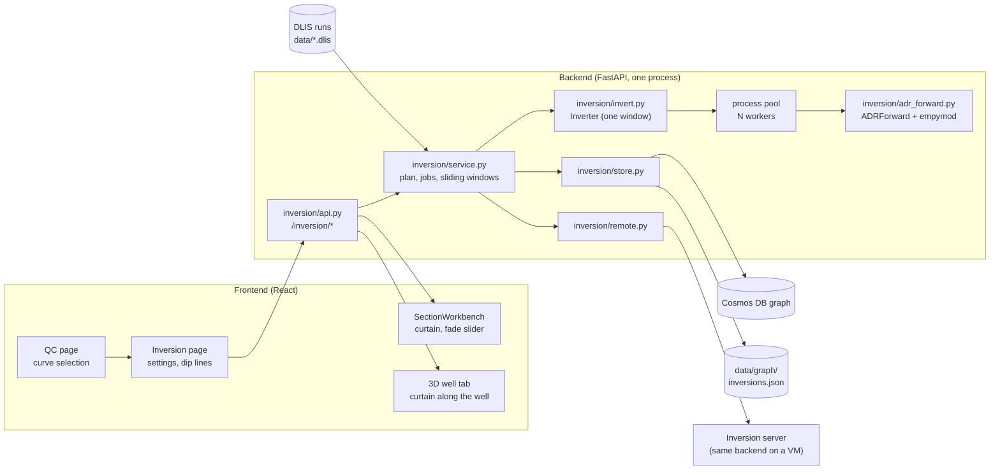
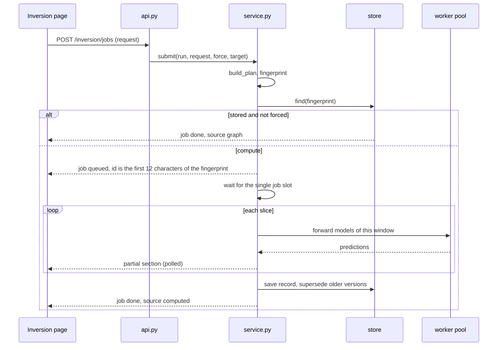
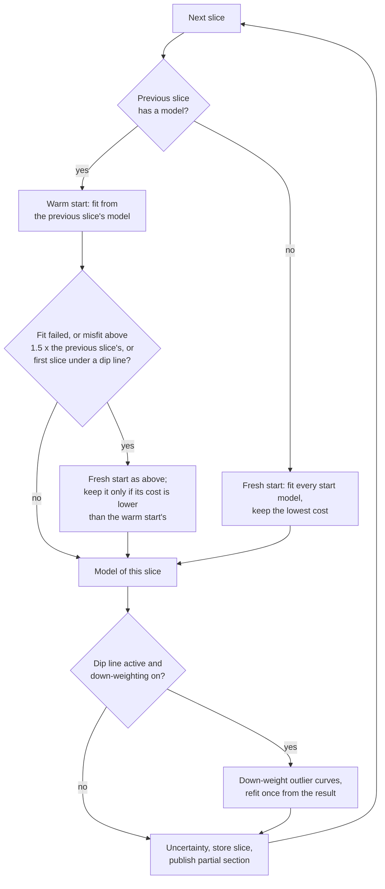

# Inversion reference: architecture, algorithms and behaviour

This document describes the inversion as it is implemented in the code today (inversion version `5`,
`INVERSION_VERSION` in [backend/inversion/service.py](../../backend/inversion/service.py)). The other files in this
folder are plans and studies written before or during the build; where they disagree with this document, the code and
this document are right.

Every number here is a constant in the code or was measured by running the code. Section 16 lists the constants
with their location, and section 9.4 says how the measurements were made.

**Contents**

1. [What the inversion does](#1-what-the-inversion-does)
2. [Architecture](#2-architecture)
3. [From a request to a result](#3-from-a-request-to-a-result)
4. [Data preparation](#4-data-preparation)
5. [Forward model](#5-forward-model)
6. [The inverse problem for one window](#6-the-inverse-problem-for-one-window)
7. [Optimiser](#7-optimiser)
8. [Sliding-window driver](#8-sliding-window-driver)
9. [When a window is finished: quick mode, full mode and the evaluation budget](#9-when-a-window-is-finished-quick-mode-full-mode-and-the-evaluation-budget)
10. [Uncertainty and the fade slider](#10-uncertainty-and-the-fade-slider)
11. [Dip-line constraints and partial re-runs](#11-dip-line-constraints-and-partial-re-runs)
12. [Result fields and misfit definitions](#12-result-fields-and-misfit-definitions)
13. [Storage, fingerprints and versions](#13-storage-fingerprints-and-versions)
14. [Compute: workers, server and grid runs](#14-compute-workers-server-and-grid-runs)
15. [3D facet inversion](#15-3d-facet-inversion)
16. [Constants and limits](#16-constants-and-limits)
17. [Known limitations and unconfirmed assumptions](#17-known-limitations-and-unconfirmed-assumptions)

---

## 1. What the inversion does

The inversion takes the ADR resistivity and geosignal curves selected on the QC page, over an MD interval of one run,
and finds a layered earth that reproduces them.

- **Model:** a stack of 1 to 4 planar layers. Each layer has a horizontal resistivity Rh and a vertical resistivity
  Rv (transverse isotropy). All boundaries are parallel and share one dip along the well azimuth. This is the
  "1.5D" model: 1D layering, evaluated along the real 3D well path.
- **One model per slice:** the interval is cut into slices (default 4 ft). Each slice gets its own model, fitted to
  the data in a window centred on the slice (default 20 ft). Neighbouring windows overlap, and each fit starts from
  its neighbour's result.
- **Output:** per slice, the layer resistivities, boundary depths, dip and their uncertainties; per channel, the
  measured and modelled curves and their misfit. The Inversion tab draws this as a curtain section; the 3D well tab
  drapes the same section along the well.

Two request settings control how hard each window is fitted:

| Setting | Effect |
|---|---|
| `quick` on | each trust-region solve may use at most **6** residual evaluations |
| `quick` off (default in the 1.5D UI) | at most **12** |

There is **no misfit target**. A solve ends when it runs out of this budget or meets scipy's convergence tolerances;
in practice it is almost always the budget (section 9).

## 2. Architecture



| Module | Role |
|---|---|
| [backend/data/loader.py](../../backend/data/loader.py) | Reads a DLIS run. Sets nulls and tool-clip values to NaN and keeps the clip masks. |
| [backend/data/quadrants.py](../../backend/data/quadrants.py) | Top/right/bottom/left quadrant curves from 32-bin images. |
| [backend/qc/selection.py](../../backend/qc/selection.py) | QC auto-pick of 5 to 10 curves; the inversion's default input. |
| [backend/inversion/api.py](../../backend/inversion/api.py) | HTTP endpoints and request validation (`InversionRequest`). |
| [backend/inversion/service.py](../../backend/inversion/service.py) | Maps curves to channels (the *plan*), runs jobs, drives the sliding windows, computes uncertainty, serialises results. |
| [backend/inversion/invert.py](../../backend/inversion/invert.py) | `Inverter`: the fit of one window. Parameter layout, residual, Jacobian, optimiser call, worker pool. |
| [backend/inversion/adr_forward.py](../../backend/inversion/adr_forward.py) | `ADRForward`: tool response of a dipping layered TIV earth via `empymod`. |
| [backend/inversion/store.py](../../backend/inversion/store.py), [cosmos_store.py](../../backend/inversion/cosmos_store.py), [graph_io.py](../../backend/inversion/graph_io.py) | Finished inversions: Cosmos DB graph and the JSON snapshot. |
| [backend/inversion/remote.py](../../backend/inversion/remote.py) | Forwards a job to the inversion server and mirrors its progress. |
| [backend/inversion/run_grid.py](../../backend/inversion/run_grid.py) | Headless runner for a grid of inversions. |
| [backend/inversion/layers.py](../../backend/inversion/layers.py) | Boundary geometry of a result for the 3D well tab. |
| [backend/inversion/facets.py](../../backend/inversion/facets.py), [facets_api.py](../../backend/inversion/facets_api.py) | 3D facet inversion (section 15). |
| [backend/inversion/misfit_study.py](../../backend/inversion/misfit_study.py), [ls_weight_study.py](../../backend/inversion/ls_weight_study.py) | Command-line studies; not used by the app. |
| [frontend/src/pages/InversionPage.jsx](../../frontend/src/pages/InversionPage.jsx) | Settings, run button, dip-line options, previous inversions. |
| [frontend/src/components/inversion/SectionWorkbench.jsx](../../frontend/src/components/inversion/SectionWorkbench.jsx), [sectionModel.js](../../frontend/src/components/inversion/sectionModel.js) | Curtain section, uncertainty grid and the fade slider. |
| [frontend/src/pages/InversionManagerPage.jsx](../../frontend/src/pages/InversionManagerPage.jsx) | Inversion management tab: stored inversions by well, their curves and statistics, delete. |

### Endpoints

| Method and path | Purpose |
|---|---|
| `GET /inversion/defaults?run=` | Suggested interval, channel labels, limits. |
| `GET /inversion/targets` | Whether the local backend and the inversion server can compute. |
| `POST /inversion/plan` | The plan for a request: used channels with weights, ignored curves, warnings, estimated stations and slices. Nothing is computed. |
| `POST /inversion/section` | Well path and measured channels of the interval, so dip lines can be drawn before inverting. |
| `POST /inversion/jobs` | Start a job, or return the stored result of the same request. |
| `GET /inversion/jobs/{id}` | Status, progress, the partial section while running, the result when done. |
| `GET /inversion/jobs?run=` | Finished jobs of a run, newest first, without results. |
| `GET /inversion/jobs/{id}/layers` | Boundary geometry and slices for the 3D well tab. |
| `GET /inversion/records` | Every stored inversion of every run, superseded versions included, with its request, plan and key statistics but no result arrays. Used by the Inversion management tab. |
| `DELETE /inversion/records/{fingerprint}` | Delete one stored inversion (section 13). |

## 3. From a request to a result



- **One job at a time.** A semaphore (`_slot`) lets one 1.5D or facet job compute at a time in a backend; others wait
  in status `queued`. Each job runs in a background thread and owns one process pool.
- **Job id.** The first 12 characters of the request fingerprint (section 13). The same request therefore has the
  same id everywhere.
- **Live section.** While a job runs, `job.partial` holds the slices finished so far; the page polls
  `GET /inversion/jobs/{id}` and draws them.
- **Progress bar.** `progress = evaluations / budget`, capped at 0.99, with
  `budget = slices x N x (2 if down-weighting) + 2N` and N the evaluation limit of section 9. The budget does not
  count the second solve of the phase-first fit or restarts, so the bar can reach 99 % before the job is finished.

## 4. Data preparation

### 4.1 Clip values are missing data

The ADR processing writes exactly 2000 or 5000 ohm-m where a resistivity is beyond the tool's range. The loader sets
these to NaN:

- every `AR`/`ZR` sample at or above `CLIP_OHMM` = 1999 ohm-m (curves and image bins);
- every vendor-corrected `C` sample whose uncorrected twin is clipped (the `C` curves carry a transformed copy of the
  clip value, for example 2442.3, 9675.3 or 14466.8 ohm-m).

Quadrant sectors and azimuthal averages skip clipped bins. A quadrant with fewer than 4 of its 8 bins usable is
missing (`MIN_SECTOR_BINS`). The masks stay in `WellRun.clipped`, so QC can report a clipped fraction and reject
curves that are clipped on more than 50 % of their samples. The 3D well view still draws clipped samples at the clip
value.

### 4.2 The plan: curves to channels

`build_plan` maps each selected curve onto forward-model channel labels. The first curve that claims a label wins.

| Selected curve | Channels it gives | Kind |
|---|---|---|
| `AR<f><s>{P,A}` and its `C` twin | the averaged channel | `avg` |
| `ZR<f><s>{P,A}` image, 16/32/48 in | top and bottom 90-degree sectors of the image | `top`, `bottom` |
| `ZR..T` / `ZR..B` curve | that sector of the image, or the delivered curve when the run has no image | `top` or `bottom` |
| `ZR{M,L}{50,66,82}{P,A}` image | top and bottom sectors, long spacing, guessed geometry | `top`, `bottom` |
| `ZG<f><s>{P,A}` image | top sector of the geosignal | `geosignal` |
| `ZR..L` / `ZR..R`, conventional logs, unknown spacing | none; listed under `ignored` with the reason | |

`f` is the frequency letter (H = 2 MHz, M = 500 kHz, L = 125 kHz) and `s` the spacing in inches.

### 4.3 Weights

| Channel | Weight |
|---|---|
| Phase resistivity | 1 |
| 2 MHz attenuation resistivity, `calibration` on | 0.5 |
| 500 kHz and 125 kHz attenuation resistivity, `calibration` on | 0 (shown for QC, not fitted) |
| Any attenuation resistivity, `calibration` off | 1 |
| Geosignals | 1, except `ZGL112AT` at 0.25 |
| Long spacing 50/66/82 in | multiplied by `GUESSED_GEOMETRY_WEIGHT` = 1.0 |
| VC-2, 16 in 2 MHz `AR` and `ZR` | multiplied by 0 (`WELL_CHANNEL_WEIGHTS`), with a plan warning |

A channel with weight 0 stays in the result with its measured and modelled curve and its misfit, so it can be judged,
but it does not influence the model.

### 4.4 Noise level per channel

Each channel has a standard deviation sigma in its inversion unit (log10 ohm-m for resistivities, degrees or dB for
geosignals):

- **Averaged `AR` channels:** the floor, 0.02 decades (about 4.7 %).
- **Sectors and geosignals:** estimated from the data over the whole interval, as
  `1.4826 x MAD(first differences) / sqrt(2)`, never below the floor (0.02 decades, 0.5 deg, 0.05 dB).

The fit weights a channel by `weight / sigma`.

### 4.5 Stations and missing samples

- **Stations:** the DLIS samples between `md_min_ft` and `md_max_ft`, thinned to about one per `step_ft`. At most
  250 stations and 1500 ft.
- **Units:** resistivities are fitted as log10 of the value; geosignals as delivered.
- **Missing data:** a station is kept while at least one weighted channel has a value there and the trajectory
  (TVD, INC, AZI, UTMX, UTMY) is complete. A missing value (clipped, null, non-positive) drops out of the fit for that
  channel at that station only.
- **Coordinates:** north, east, down in metres from UTM and TVD, relative to the mean position of the interval's
  stations. Boundary depths inside the fit are in feet of TVD relative to that reference.

## 5. Forward model

`ADRForward.predict(model, trajectory)` returns every channel at every station. It calls `empymod.bipole` once per
station with magnetic point dipoles in a layered TIV medium (digital linear filter `key_201_2012`).

### 5.1 Tool geometry

Positions are along the tool axis from the R1/R2 midpoint, positive downhole.

| Element | Position |
|---|---|
| Transmitters T1 to T6 | plus and minus 16, 32, 48 in |
| Receivers R1, R2 | plus and minus 4 in (8 in apart) |
| Receiver R3 (tilted) | +64 in |
| Receiver tilt | 45 degrees |

### 5.2 Channels

| Channel | How it is modelled |
|---|---|
| `AR<f><s>{P,A}` | Coaxial transmitter into R1 and R2. The azimuthal mean of a tilted receiver is `cos(tilt) x Hzz`, so the averaged curve is the coaxial ratio. Compensated: the mean of the uphole and downhole transmitter. |
| `ZR<f><s>{P,A}{T,B}`, 16/32/48 in | Same pair with the receivers looking at each of 32 azimuth bins. The uphole transmitter at bin psi is paired with the downhole transmitter at psi + 180 degrees. Converted to apparent resistivity per bin, then the 8 bins of a quadrant are averaged as conductivity. |
| `ZR{M,L}{50,66,82}{P,A}{T,B}` | T2/T4/T6 into R1 (near) and R3 (far), not compensated. The spacing is to the R1-R3 midpoint. This pairing is inferred, not published. |
| `ZG<f><s>{P,A}T` | One transmitter into R3 alone, spacing `s = 64 - T`. Each bin minus the mean of all 32 bins, as phase (deg) and attenuation (dB); the 8 bins of the top quadrant are averaged. |

For one receiver pair with complex voltage ratios `up` and `dn` (near over far, for the uphole and downhole
transmitter):

```
phase       = -0.5 x (angle(up) + angle(dn))          degrees
attenuation =  10  x (log10|up| + log10|dn|)          dB
```

### 5.3 Apparent resistivity

Phase and attenuation are converted to apparent resistivity with a table: the same tool geometry in a homogeneous
isotropic whole space, at 260 log-spaced resistivities from 0.1 to about 1995 ohm-m. The tables are made monotonic and
interpolated in log resistivity. A prediction outside the table takes the end value.

### 5.4 Dielectric effect

- **Earth:** each layer gets a relative permittivity from its resistivity, `eps_r = 108.5 x R^-0.35 + 5`
  (`permittivity`). The horizontal permittivity uses Rh and the vertical one uses Rv. This gives about 79 at 3 ohm-m,
  54 at 10 and 27 at 100.
- **Transform:** the apparent-resistivity tables assume `eps_r = 1` (`transform_eperm`).

The mismatch between the two reproduces the bias measured on Z-20, where 2 MHz attenuation read high and phase did
not:

| At 10 ohm-m | Model: attenuation reads | Z-20 study measured |
|---|---|---|
| `ARH16A` | +18 % | +21 % |
| `ARH32A` | +11 % | +14 % |
| `ARH48A` | +9 % | +13 % |

The model also predicts 2 MHz phase reading 2 to 4 % low at 10 ohm-m, and 2 MHz attenuation resistivity rising steeply
above about 40 ohm-m (at 40 ohm-m `ARH32A` reads +67 % and `ARH16A` is off the scale). `ADRForward(dielectric=False)` gives the old model with `eps_r = 1` everywhere. The empirical
Z-20 correction table that this replaced is gone; `LevelCorrection` remains in the code for studies but the app does
not use it.

### 5.5 Earth geometry

Boundaries are planes with unit normal `n = (-sin d cos a, -sin d sin a, cos d)` in north, east, down, where `d` is
the dip and `a` the dip azimuth. A boundary with depth `b` at the reference point has TVD

```
TVD(N, E) = b + tan(d) x (N cos a + E sin a)
```

so a positive dip means the beds deepen along the azimuth. In the 1.5D inversion `a` is the mean well azimuth of the
window, so the dip is the apparent dip along the well. For each station the model is rotated into the bedding frame;
the station's depth along the normal and the tool's relative angle go to `empymod`.

## 6. The inverse problem for one window

### 6.1 Parameters

For `K` layers the parameter vector is

```
x = [ b1, t2 .. t(K-1),  log10 Rh1 .. log10 RhK,  log10(Rv/Rh),  dip ]
```

| Parameter | Unit | Bounds | Finite-difference step |
|---|---|---|---|
| `b1`: first boundary, TVD relative to the reference | ft | window TVD range, 40 ft beyond each end | 0.05 ft |
| `t2 ..`: thickness of each inner layer | ft | 0.5 to 60 | 0.05 ft |
| `log10 Rh` per layer | decades | `rh_min_ohmm` to `rh_max_ohmm` (default 0.1 to 1000) | 0.004 (0.9 %) |
| `log10(Rv/Rh)`, one value shared by all layers | decades | 0 to 1 (Rv/Rh from 1 to 10) | 0.004 |
| `dip` along the well azimuth | degrees | plus and minus 15 (wider under a dip line, section 11) | 0.05 deg |

That is `2K + 1` parameters: 3, 5, 7 or 9 for 1 to 4 layers.

### 6.2 Objective

With `obs` the measured values, `F(x)` the forward model, `w_c` the channel weight and `sigma_c` its noise level, the
fit minimises

```
cost(x) = 0.5 x sum over stations i and channels c of  [ w_c x (F_ic(x) - obs_ic) / sigma_c ]^2
        + 0.5 x sum of prior terms (dip lines only, section 11)
```

Entries with weight 0 or without a measured value are left out. There is no smoothness or damping term between
layers or between slices; continuity along the well comes only from the overlapping windows and the warm start.

### 6.3 Anisotropy from phase only

Attenuation is the measurement most affected by the dielectric effect, so it is not allowed to set Rv/Rh. When a fit
has at least one weighted attenuation channel and one weighted non-attenuation channel, it runs in two stages
(`FitConfig.anisotropy_from_phase`, on in the app through `ANISOTROPY_FROM_PHASE`):

1. **Phase stage:** all attenuation channels (attenuation resistivities and attenuation geosignals) get weight 0.
   Every parameter is free.
2. **Full stage:** all channels at their weights, started from stage 1, with `log10(Rv/Rh)` held at its stage 1
   value. Its Jacobian column is zero, so it costs no forward models.

A selection without weighted attenuation runs a single stage.

## 7. Optimiser

Each stage is one call to `scipy.optimize.least_squares` with the trust-region reflective method
(`method="trf"`, bounds as above, `x_scale="jac"`, `max_nfev = N`, default tolerances
`ftol = xtol = gtol = 1e-8`).

- **Jacobian:** forward finite differences with the steps of section 6.1. One Jacobian needs the base model plus one
  perturbed model per free parameter. These are the tasks sent to the worker pool, so one Jacobian of a 3-layer model
  is 7 forward models in parallel (the base one is usually already cached).
- **Forward model sweep:** one evaluation of all stations of the window and all channels for one parameter vector.
  This is the unit of cost. A 20 ft window at a 4 ft step has 5 or 6 stations, so a sweep is 5 or 6 `empymod` calls.
- **Cache:** sweeps are cached by parameter vector within one `Inverter`, so the start point, the accepted point and
  the final prediction are not recomputed.
- **Start check:** before a fit, the start model is evaluated; a non-finite residual raises an error that names the
  channel and stations.

### 7.1 Start models

When a window is started fresh (section 8), `default_starts` builds the starts from the data:

- **Resistivity levels:** per station, the median of the weighted phase resistivities. `low` is the 15th percentile
  of that over the window and `high` the 90th.
- **Layers:** Rh = `low`, `high`, then the midpoint for further layers. `Rv/Rh = 1.26`. Dip 0.
- **Boundaries:** three starts for 2 or more layers, with the first boundary at the shallowest TVD of the window, the
  middle, and 5 ft below the deepest; further boundaries 6 ft apart. A 1-layer model has one start.

`multistart` fits every start and keeps the one with the lowest cost. A start that cannot be evaluated is skipped.

## 8. Sliding-window driver

`run_inversion` walks the slices in MD order.

- **Slices:** back to back, `slice_ft` wide (default 4, allowed 1 to 50), at most 300.
- **Data window:** the stations within `window_ft / 2` of the slice centre (default 20 ft, allowed 2 to 200, at
  least `slice_ft`). A slice with fewer than 3 stations in its window is skipped.
- **Ownership:** each station's modelled curves come from the slice whose centre is nearest.



The misfit in the restart test is the normalised misfit of the window, `sqrt(mean((obs - pred)^2 / sigma^2))` over
the weighted channels.

**This restart test is the only place where the code judges a fit.** It compares the window with its neighbour, not
with an absolute target. A slice whose warm start is no worse than 1.5 times the previous slice's misfit is accepted
whatever its misfit is.

## 9. When a window is finished: quick mode, full mode and the evaluation budget

### 9.1 The rule

One trust-region solve stops at the first of:

| Stop reason (scipy status) | Condition |
|---|---|
| Budget (0) | `N` residual evaluations used: **N = 6 in quick mode, 12 in full mode** |
| Gradient (1) | scaled gradient norm below `1e-8` |
| Cost (2) | relative cost reduction of a good step below `1e-8` |
| Step (3) | relative step size below `1e-8` |
| Cost and step (4) | both of the two above |

The evaluation of the start point counts as the first of the `N`. So a quick solve tries at most 5 steps and a full
solve at most 11. Every accepted step is followed by a new Jacobian.

Nothing else decides that a window is "good". There is no misfit threshold, no check that the solve converged, and
the result does not record why a solve stopped. A window that stopped on the budget is reported the same way as one
that converged; its quality shows only in `misfit_normalised` and in the uncertainties.

### 9.2 Upper bounds per slice

With `N` as above, `P` free parameters (`2K + 1`, one less in the full stage of a two-stage fit) and `S` start models
(3, or 1 for a single layer):

| Unit | Residual evaluations, at most | Forward model sweeps, at most |
|---|---|---|
| One solve | `N` | `N x (1 + P)` |
| One fit, single stage | `N` | `N x (1 + P)` |
| One fit, two stages (default) | `2N` | `N x (1 + P) + N x P` |

| Slice outcome (two-stage fits, 3 layers) | Fits | Solves | Residual evaluations, quick / full |
|---|---|---|---|
| Warm start accepted | 1 | 2 | 12 / 24 |
| First slice of the job (fresh start only) | 3 | 6 | 36 / 72 |
| Warm start rejected, fresh start | 1 + 3 | 8 | 48 / 96 |
| Entering a dip line with an anchor (one extra start) | 1 + 4 | 10 | 60 / 120 |
| Any of the above plus the down-weighting refit | + 1 | + 2 | + 12 / + 24 |

For a selection with phase channels only, halve the solves and evaluations.

The 3D facet inversion uses `N = 8` in quick mode (its default) and 15 otherwise (section 15).

### 9.3 What the result reports

`forward_evaluations` in a result is the sum of the residual evaluations of the fit that was **kept** for each
slice. It does not include Jacobian sweeps or discarded starts. Before version 5 (single-stage fits) this was at
most `N` per slice; in the stored version 2 to 4 results it is 6.0 per slice in quick mode and 11.9 to 12.0 in full
mode for runs without dip lines, which means nearly every kept fit stopped on the budget.

### 9.4 Measured behaviour

Three instrumented runs of the version 5 code on Z-20 (2026-11-20), counting every solve, residual evaluation and
forward model sweep. All use 3 layers, a 4 ft station step and a 20 ft data window (5 or 6 stations per window), with
two-stage fits. Runs A and B replay the curves of stored job `b91417cabfca` over 20200 to 20320 ft with 4 ft slices
(14 channels, 13 of them weighted). Run C replays stored job `917978fb7c50`, 20200 to 20260 ft with 8 ft slices and
one anchored dip line with down-weighting.

| | A: quick | B: full | C: quick, dip line |
|---|---|---|---|
| Slices | 30 | 30 | 8 |
| Solves | 64 | 64 | 38 |
| Solves that stopped on the budget | 64 (100 %) | 62 (97 %) | 38 (100 %) |
| Solves that converged | 0 | 2 (cost tolerance) | 0 |
| Slices that kept their warm start | 29 of 29 | 29 of 29 | all but the slice entering the line |
| Residual evaluations per warm-started slice | 12 | 24 (23 to 24) | 12, plus 12 for each refit |
| Sweeps per warm-started slice, mean | 69 | 141 | 73 |
| First slice (3 starts): evaluations, sweeps | 36, 202 | 72, 428 | 36, 177 |
| Slice entering the dip line (1 + 4 fits): evaluations, sweeps | | | 60, 320 |
| Total sweeps | 2210 | 4528 | 1302 |
| Result `misfit_normalised` | 2.50 | 2.33 | 1.46 |
| Result `rms_percent_used` | 11.9 % | 10.9 % | 6.1 % |
| Slice misfit, median / worst | 2.09 / 3.88 | 2.09 / 3.61 | 1.40 / 1.86 |
| Median `rh_std_log` (decades) | 0.99 | 1.29 | 0.05 |
| Layers with `rh_std_log` at the 2.0 cap | 34 % | 31 % | 33 % |
| Median `boundary_std_ft` | 15.3 | 12.8 | 1.6 |
| Wall time, 4 workers, three runs sharing a 10-core laptop | 276 s | 523 s | 223 s |

What this shows:

- **Solves stop on the budget.** In quick mode every solve used all 6 evaluations; in full mode 62 of 64 used all 12.
  The solves had not converged to scipy's tolerances when they stopped.
- **Full mode costs twice the work for a small gain here.** It ran 2.05 times the sweeps of quick mode and lowered the
  normalised misfit from 2.50 to 2.33. The median slice misfit did not change.
- **Warm starts are almost always kept.** Apart from the first slice and the slice entering a dip line, no slice was
  restarted, so the typical cost per slice is the "warm start accepted" row of section 9.2.
- **Observed sweeps are below the bound.** A warm-started quick slice could use up to 90 sweeps (two stages, 7 and 6
  free parameters) and used 69 on average, because rejected steps need no new Jacobian.
- **About a third of the layers are not resolved.** They sit at the 2.0-decade uncertainty cap: the data in the
  window does not constrain that layer's resistivity.
- **These are three runs on one well.** They show how the stopping rule behaves; they are not a study of the best
  budget.

The instrumentation wrapped `Inverter.fit`, `Inverter._solve` and `Inverter._theory_batch` in a script outside the
repository; the results were not saved to the store.

## 10. Uncertainty and the fade slider

There are two parts: what the backend computes per slice, and how the frontend turns it into the "Fade uncertain"
slider.

### 10.1 Backend: posterior standard deviations per slice

After the final fit of a slice, `_uncertainty` linearises the problem at the solution:

```
J    = Jacobian of the weighted residuals at the solution (earth parameters only)
s2   = max(1, 2 x cost / (rows - parameters))          reduced chi-square, never below 1
cov  = inverse(J' J + 0.01 x I) x s2
```

`rows` counts the residual rows that are not identically zero. The `0.01 x I` term (`UNCERTAINTY_DAMPING`) keeps the
matrix invertible for parameters the data cannot see: such a parameter gets a standard deviation of about
`10 x sqrt(s2)`, which is then capped.

| Field per slice | Meaning | Cap |
|---|---|---|
| `rh_std_log` (one per layer) | 1-sigma of log10 Rh, in decades. 0.1 means a factor 1.26; 0.3 a factor 2 | 2.0 |
| `boundary_std_ft` (one per boundary) | 1-sigma of the boundary depth at the reference point. Boundaries are sums of the fitted depth and thicknesses, so their covariance is propagated through that sum | 50 ft |
| `dip_std_deg` | 1-sigma of the dip | 90 deg |

What this is and is not:

- It is a **linearised, local** estimate at the solution: a Gaussian approximation from the Jacobian. It does not
  see other minima, and at a solve that stopped on the budget it describes the curvature at a point that may not be
  the minimum.
- `s2 >= 1` means a fit better than the noise model is not rewarded with smaller uncertainties, and a poor fit
  inflates them.
- The anisotropy is held in the final stage of a two-stage fit, so its uncertainty is not estimated and does not
  enter the other standard deviations.
- Slices copied from a base job in a partial re-run keep the uncertainties of that job.

### 10.2 Frontend: the uncertainty of each section cell

`buildSection` in `sectionModel.js` rasterises the slices onto a grid: columns a quarter of a slice wide, 300 rows
over the well's TVD plus and minus the "Section ± ft" setting (120 rows in the 3D curtain). For a cell at
`(MD, TVD)`:

- **Slices view:** the cell takes the layer of the slice that owns its MD. `sigma` is that layer's `rh_std_log`.
- **Mean view:** the cell takes the mean log10 Rh over every slice whose data window covers its MD. `sigma` is the
  mean of those slices' `rh_std_log` for their layer at that cell.
- **Spread:** the standard deviation of log10 Rh across those covering slices, in both views. It measures how much
  overlapping windows disagree.

```
uncertainty = sqrt(sigma^2 + spread^2)          decades of Rh
```

Hovering a cell shows this as "uncertainty ×f" with `f = 10^uncertainty`, the 1-sigma factor on Rh. Results stored
before version 3 have no `rh_std_log`; for those, `sigma` is replaced by `0.3 x distance from the well / half-height`.

Only `rh_std_log` is used for the display. `boundary_std_ft` and `dip_std_deg` are in the result but nothing draws
them yet.

### 10.3 Frontend: the fade slider

Every cell gets a **rank**: its uncertainty percentile among all cells of the section, from 0 (most certain) to 1
(most uncertain). With the slider at `fade` (0 to 1, shown as 0 to 100 %), a cell is drawn with opacity

```
alpha = clamp( ((1 - fade) - rank) / 0.08 + 1,  0,  1 )          alpha = 1 when fade = 0
```

| Slider | Fully opaque | Fading | Hidden |
|---|---|---|---|
| 0 % | everything | | |
| 25 % | rank up to 0.75 | 0.75 to 0.83 | above 0.83 |
| 50 % | rank up to 0.50 | 0.50 to 0.58 | above 0.58 |
| 100 % | only the single most certain value | 0 to 0.08 | above 0.08 |

So the slider hides the most uncertain part of the picture first, over a soft edge 8 percentile points wide.

Read it with these points in mind:

- **It is relative, not absolute.** The slider position is a percentile of this section, not a confidence level.
  50 % hides the less certain half of the cells whether the inversion is good or bad. To compare two inversions, use
  the hover value or `rh_std_log`, not the slider.
- **The ranking depends on what is shown.** Cells are ranked over the displayed TVD band, so changing
  "Section ± ft" changes which cells fade at a given slider value.
- **It changes nothing in the model.** The slider is display only. It is not sent to the backend, is not part of the
  request or the fingerprint, and does not trigger or tune an inversion.
- **3D well tab:** the curtain's "Fade" slider is the same function on the slices view.

## 11. Dip-line constraints and partial re-runs

A dip line is a segment drawn on the MD/TVD section (`lines` in the request).

- **Active range:** a line constrains every slice whose centre lies within the line's MD span plus and minus half a
  data window.
- **Conversion:** the line is converted to a dip along the window's azimuth and a boundary depth at the reference
  point, using the well's horizontal displacement. Several active lines give the mean dip. The dip is limited to plus
  and minus 60 degrees.
- **Dip prior:** a Gaussian term `(dip - dip_line) / dip_sigma_deg` is added to the residual (default 2 degrees; the
  UI offers 0.5, 1, 2, 5 and 10). The dip bound of the slice is widened to the line's dip plus 5 degrees when that
  exceeds 15.
- **Anchor:** an anchored line also adds `(boundary - depth_line) / boundary_sigma_ft` (default 2 ft; the UI offers
  1, 2, 5 and 10) on the model boundary nearest to it. Each boundary takes one anchor at most.
- **Starts:** on entering a constrained range the slice is started fresh, with the start models set to the line's
  dip, plus one start with the boundaries placed on the anchors.
- **Down-weighting** (`downweight_misfit`, on by default with lines): after the constrained fit, each channel's
  normalised misfit `chi` in the window is compared with `tau = max(2.0, 1.5 x median chi)`. A channel above `tau`
  gets its weight multiplied by `(tau / chi)^2`, not below 0.05, and the slice is refitted once. This needs at least
  3 weighted channels. The factors are stored per slice (`downweighted`) and averaged per curve
  (`downweight_factor`).

**Partial re-run.** With `base_job_id`, slices outside the re-run range are copied from the base job and only the
rest are recomputed. The range is `rerun_md_min_ft` to `rerun_md_max_ft`, or by default the lines' MD span plus and
minus half a window. The base job must be finished, of the same run, and have the same interval, step, layers, slice
and window. A copied slice also serves as the warm start for the next recomputed one.

## 12. Result fields and misfit definitions

| Field | Meaning |
|---|---|
| `md_ft`, `tvd_ft`, `inclination_deg` | The stations. |
| `curves[]` | Per channel: `label`, `kind`, `unit`, `source`, `obs`, `pred`, `used`, `weight`, `sigma`, and the misfits below. |
| `slices[]` | Per slice: centre and extent, data-window extent, `layers` (`rh`, `rv`), `boundary_tvd_ft` at each station of the window, `dip_deg`, `dip_azimuth_deg`, `misfit_normalised`, `rh_std_log`, `boundary_std_ft`, `dip_std_deg`, and `constraint` / `downweighted` when lines applied. |
| `model` | A single-model summary for tables and the 3D tab: the median of each layer's properties and of the dip over the slices, and boundary TVDs per station from the owning slice. |
| `forward_evaluations` | See section 9.3. |
| `rerun`, `constraints` | Present for partial re-runs and for runs with lines. |

| Misfit | Definition |
|---|---|
| `rms` (per curve) | RMS of `obs - pred` in the inversion unit. |
| `rms_percent` (resistivities) | `100 x (10^rms - 1)`. |
| `rms_normalised` (per curve) | RMS of `(obs - pred) / sigma`. About 1 means the curve is fitted to its noise level. |
| `mean_residual_percent` | `100 x (10^mean(obs - pred) - 1)`: the systematic offset of a resistivity curve. |
| `misfit_normalised` (result) | RMS of `(obs - pred) / sigma` over all samples of the weighted channels. |
| `rms_percent_used` (result) | `rms_percent` over all samples of the weighted resistivity channels. |
| `misfit_normalised` (slice) | The same normalised misfit over the slice's data window. |

Channel weights do not enter these numbers; a channel with weight 0.5 counts in full, and a channel with weight 0 is
left out of the result-level numbers.

## 13. Storage, fingerprints and versions

- **Fingerprint:** SHA-256 of the validated request with defaults filled in (without `force` and `target`), the used
  labels and weights, and `INVERSION_VERSION`. A repeated request finds its stored result and returns it with
  `source: "graph"` without computing, unless `force` is set.
- **Request key:** the same hash without the weights and the version. When the code changes and the version is
  bumped, a new result with the same request key supersedes the old one, which is then hidden from listings.
- **Version:** bump `INVERSION_VERSION` whenever a change alters results. Version 5 covers clip masking, the
  dielectric model, the attenuation weights, phase-only anisotropy and per-channel missing data.
- **Stores:** `DualStore` reads the Cosmos DB graph and writes both Cosmos and the snapshot
  `data/graph/inversions.json`; `SnapshotStore` uses only the snapshot when Cosmos is disabled or unreachable;
  `MemoryStore` (`RESIST_STORE=memory`) keeps nothing. A job that cannot be saved is still served from memory.

Facet inversions are not stored; they live in backend memory under a random id.

### Running without Cosmos

The app runs on the snapshot `data/graph/inversions.json` alone. At start-up the backend falls back to it, within a
few seconds, when Cosmos is switched off (`"enabled": false` in `backend/cosmos.config.json`, or
`COSMOS_ENABLED=false`), when `az` cannot fetch the key, when the account no longer exists, or when the key is
rejected; `/health` then reports `store: snapshot` with the reason. Listing, opening, computing, saving and deleting
inversions all work on the snapshot. Two points:

- The fallback is decided at start-up. A backend that connected to Cosmos and then loses it keeps trying it, waiting
  up to 5 s per read before answering from the snapshot, until it is restarted.
- Inversions computed elsewhere reach this backend only through the committed snapshot file. Commit
  `data/graph/inversions.json` to share results.

### Listing and deleting stored inversions

The **Inversion management** tab lists every stored inversion grouped by well: run, MD interval, settings, selected
curves and fitted channels with weights, stations and slices, misfit, compute time, finish time, code version,
whether it is superseded, and which store holds it (`cosmos`, `snapshot`). The listing comes from the snapshot
(full statistics) merged with a light Cosmos query; an inversion that exists only in Cosmos shows no misfit until the
next start-up sync copies it into the snapshot.

Deleting an inversion:

- removes it from the Cosmos graph and from the backend's snapshot file, and from that backend's finished jobs. In
  Cosmos the inversion and its layers are dropped; the run's stations and measured values, which other inversions
  share, stay;
- is refused (HTTP 409) while that inversion is being computed, and returns 404 for an unknown fingerprint;
- does not bring back a result that the deleted one had superseded: that older record stays hidden from the
  Inversion and 3D well tabs, but it is still listed (and can be deleted) on the management tab;
- can be undone by another backend. The start-up sync uploads every snapshot record that Cosmos lacks, so a backend
  whose snapshot still holds the inversion puts it back into Cosmos when it starts. To remove an inversion for good,
  the snapshot file committed to the repository must not contain it either.

## 14. Compute: workers, server and grid runs

- **Worker pool:** one pool per job, `RESIST_INVERSION_WORKERS` processes (default 6). Workers are spawned, not
  forked. Each worker builds its own `ADRForward` and transform tables once, then evaluates forward model sweeps.
- **Parallelism is per Jacobian.** A job sends at most `P + 1` sweeps at once, so more than about 10 workers per job
  sit idle. To use a large machine, run several jobs side by side (the grid runner does this).
- **BLAS threads:** workers run with `OPENBLAS_NUM_THREADS=1` and `VECLIB_MAXIMUM_THREADS=1`
  (`RESIST_WORKER_BLAS_THREADS` overrides). Multi-threaded BLAS in every worker oversubscribes the cores and memory.
- **Shutdown:** the backend stops its pools on shutdown and at interpreter exit. A worker also exits by itself within
  about 2 seconds if its parent process disappears.
- **Server target:** with `target: "server"` the local backend forwards the request to the inversion server
  (`RESIST_INVERSION_SERVER_URL` or `backend/inversion_server.json`), polls it at most once per second, mirrors the
  status and the partial section, and saves the finished result locally too. The target is not part of the
  fingerprint.
- **Grid runner:** `python -m backend.inversion.run_grid <grid.json>` expands a grid of runs, intervals and settings,
  skips points already stored, and computes the rest in child processes.

## 15. 3D facet inversion

`backend/inversion/facets.py` (`/inversion3d/*`) is a separate, coarser inversion that lets the beds tilt sideways.
It shares the `Inverter`, the forward model, the plan and the job slot with the 1.5D inversion.

| | 1.5D inversion | 3D facet inversion |
|---|---|---|
| Dip | along the well azimuth | along and across the well (two angles, so the dip azimuth is free) |
| Directional data | top and bottom quadrants | all four `ZR` quadrants; top, right and left geosignal quadrants |
| Windows | 20 ft sliding window per 4 ft slice | 100 ft windows (40 to 400), half overlapping, at most 30 |
| Minimum stations per window | 3 | 6 |
| Layers | 1 to 4 (default 3) | 1 to 3 (default 2) |
| Dip bound | 15 degrees | 45 degrees (5 to 80) |
| Evaluation limit `N` | 6 quick, 12 full; full is the UI default | 8 quick, 15 full; quick is the default |
| Restart rule | misfit above 1.5 times the previous slice's | normalised misfit above 3 |
| Noise levels | from the whole interval | from each window |
| Lateral offset | not applicable | the interval-median right/left contrast of each image is removed first (`remove_lateral_offset`) |
| Worker pool | one per job | one per window |
| Uncertainty, dip lines, store | yes | no |
| Interval limit | 1500 ft | 1000 ft |

With `compare` on, each window is also fitted without the cross dip, and both misfits are reported. The right/left
sense assumes image bin 8 looks to the right of the tool looking downhole; `rotation: -1` mirrors it.

## 16. Constants and limits

| Constant | Value | Where |
|---|---|---|
| `INVERSION_VERSION` | `"5"` | service.py |
| Evaluation limit per solve | 6 quick, 12 full | service.py, `run_inversion` |
| Facet evaluation limit | 8 quick, 15 full | facets.py, `run_facets` |
| Restart factor | 1.5 | service.py, `run_inversion` |
| `DEFAULT_SLICE_FT`, `DEFAULT_WINDOW_FT` | 4, 20 | service.py |
| `MAX_STATIONS`, `MAX_INTERVAL_FT`, `MAX_SLICES` | 250, 1500, 300 | service.py |
| `MIN_WINDOW_STATIONS` | 3 | service.py |
| `SIGMA_FLOOR` | 0.02 decades, 0.5 deg, 0.05 dB | service.py |
| `CALIBRATED_ATTENUATION_WEIGHT` | 0.5 at 2 MHz, 0 at 500 and 125 kHz | service.py |
| `GEOSIGNAL_WEIGHT` | `ZGL112AT`: 0.25 | service.py |
| `GUESSED_GEOMETRY_WEIGHT` | 1.0 | service.py |
| `WELL_CHANNEL_WEIGHTS` | VC-2, 2 MHz, 16 in: 0 | service.py |
| `ANISOTROPY_FROM_PHASE` | on | service.py |
| `DEFAULT_DIP_SIGMA_DEG`, `DEFAULT_BOUNDARY_SIGMA_FT` | 2, 2 | service.py |
| `MAX_LINE_DIP_DEG` | 60 | service.py |
| `DOWNWEIGHT_MIN_CHI`, `DOWNWEIGHT_REL_CHI`, `DOWNWEIGHT_FLOOR` | 2.0, 1.5, 0.05 | service.py |
| `UNCERTAINTY_DAMPING`, `MAX_RH_STD_LOG`, `MAX_BOUNDARY_STD_FT` | 0.01, 2.0, 50 | service.py |
| `WORKERS` | 6 (`RESIST_INVERSION_WORKERS`) | service.py |
| Dip bound, layer thickness bounds, Rv/Rh bounds | 15 deg; 0.5 to 60 ft; 1 to 10 | invert.py, `FitConfig`, `Layout.bounds` |
| Finite-difference steps | 0.05 ft, 0.004 decades, 0.05 deg | invert.py, `Layout.steps` |
| Start models | 3 (1 for a single layer) | invert.py, `default_starts` |
| `CLIP_OHMM` | 1999 | data/loader.py |
| `MIN_SECTOR_BINS` | 4 of 8 | data/quadrants.py |
| `MAX_CLIPPED` (QC) | 0.5 | qc/selection.py |
| Permittivity relation | `108.5 x R^-0.35 + 5` | adr_forward.py, `permittivity` |
| Transform table | 260 points, 0.1 to 1995 ohm-m, `eps_r = 1` | adr_forward.py, `rho_grid`, `transform_eperm` |
| Receiver spacing, tilt, R3 position | 8 in, 45 deg, +64 in | adr_forward.py |
| `FADE_RAMP` | 0.08 | frontend sectionModel.js |
| Section grid | columns of slice/4, 300 rows (120 in 3D) | frontend sectionModel.js, InversionLayers.jsx |

Request limits (`InversionRequest`): `step_ft` 0.5 to 20, `layers` 1 to 4, `slice_ft` 1 to 50, `window_ft` 2 to 200
and at least `slice_ft`, `rh_min_ohmm` and `rh_max_ohmm` up to 10000, at most 20 lines, `dip_sigma_deg` up to 30,
`boundary_sigma_ft` up to 50.

## 17. Known limitations and unconfirmed assumptions

**Fitting**

- A window is not checked for convergence, and the stop reason is not stored (section 9). In the measurements of
  section 9.4, 164 of 166 solves stopped on the budget.
- The only quality gate is relative to the previous slice. A run of equally poor slices is accepted.
- No regularisation ties neighbouring slices together; boundaries can jump between slices.
- One anisotropy ratio is shared by all layers of a slice.
- The progress bar underestimates the work of two-stage fits and restarts.

**Uncertainty**

- Linearised and local; computed at wherever the solve stopped (section 10.1).
- The fade slider ranks cells within one section and is not comparable between sections (section 10.3).

**Forward model, none of it confirmed by the vendor**

- The averaged curves are modelled as coaxial receiver pairs; the receiver tilt is 45 degrees; the bin pairing of
  the compensated image is assumed.
- The long-spacing 50/66/82 in pairing (T2/T4/T6 into R1 and R3) is inferred. These channels have full weight; the
  comparison at weight 0.25 is not finished.
- The permittivity relation is a common industry assumption, checked here only against the Z-20 2 MHz attenuation
  bias at 3 to 10 ohm-m. It has not been checked against 500 and 125 kHz attenuation, which is why those channels
  have weight 0, and not against measured data above about 40 ohm-m.
- The vendor's apparent-resistivity transform is assumed to use no dielectric correction and to ignore the mandrel
  and the borehole.
- In the facet inversion, the right/left sense of the image is assumed.

**Data**

- Clipped samples are dropped, not treated as "at least 2000 ohm-m". In very resistive beds this removes the
  information that the bed is resistive from the clipped channels.
- A quadrant needs 4 of 8 bins; with fewer usable bins it is missing rather than estimated.
