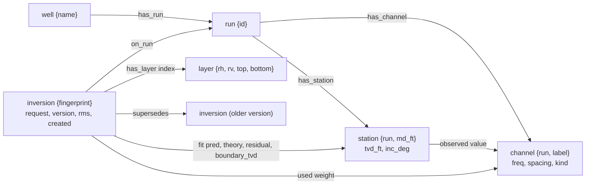

# Inversion results in an Azure Cosmos DB graph (Gremlin API)

## Goal

Store every inversion result in one shared **Azure Cosmos DB for Apache Gremlin** graph in the
hackathon's Contoso tenant, instead of only in backend memory.

- **Reuse:** a request that has already been computed is answered from the graph. Stations (depth
  points) and observed values are stored once and shared between inversions that overlap in depth.
- **Updates:** a request with the same inputs but newer inversion code adds a new version to the
  graph and links it to the old one.
- **Sharing:** the graph is a live cloud database, so all three developers see each other's results
  immediately. A JSON snapshot in the repo gives offline access and a backup.
- **Persistence:** results survive a backend restart, so the 3D well tab's inversion layers stay.

## Connection check (done 2026-11-19 15:08, read-only)

| Item | Result |
|---|---|
| Tenant | Contoso `704b7209-73fa-43f5-8e84-21cd65fe5697`, Azure CLI login with device code and MFA |
| Subscription | `ME-MngEnvMCAP833807-bvorland-1` (`2668e2c1-a6ab-42da-8bcf-edd50a6fc470`), the only one in the tenant and the default |
| Azure MCP Server | `@azure/mcp` 4.0.0-beta.9, configured in `C:\src\hackathon\.vscode\mcp.json` with `AZURE_TOKEN_CREDENTIALS=AzureCliCredential`. `initialize` succeeded, 74 tools were listed, and `subscription_list`, `group_list` and `cosmos_list` all returned 200. |
| Existing Cosmos accounts | None |
| `Microsoft.DocumentDB` provider | Registered |
| Your role | **Contributor** on the subscription, so you can create the account. The subscription has 13 resource groups belonging to other teams; this plan touches none of them. |

## Current state (checked in code)

- The interface is `POST /inversion/jobs`, with fields `run`, `curves`, `md_min_ft`, `md_max_ft`,
  `step_ft`, `layers`, `calibration` and `quick`.
- Jobs are kept in the in-memory dict `_jobs` in `backend/inversion/service.py`.
- `GET /inversion/jobs?run=` lists finished jobs, and `GET /inversion/jobs/{id}/layers` gives the
  layers for the 3D tab.
- A result (`service.serialize`) holds per station `md_ft`, `tvd_ft` and `inclination_deg`. Per
  channel it holds `obs`, `pred`, `theory`, `rms_percent` and `weight`. The model holds
  `layers[{rh, rv, top_tvd_ft, bottom_tvd_ft}]`, `dip_deg`, `dip_azimuth_deg` and
  `boundary_tvd_ft[boundary][station]`. A job has at most 250 stations.
- Nothing is persisted.

## Azure resources (to create only after approval)

| Resource | Setting | Why |
|---|---|---|
| Resource group | `resist-hackathon-rg`, region `swedencentral` | Our own group, so the cleanup removes only our work. The same region as most hackathon groups. |
| Cosmos DB account | `resist-graph-<4 random chars>`, API **Gremlin** (capability `EnableGremlin`), **serverless** capacity, one region, session consistency | Pay per request, nothing billed while idle. Serverless is enough for a few thousand writes per inversion. |
| Gremlin database | `resist` | |
| Graph (container) | `inversions`, partition key `/pk` | Every vertex has `pk` = run id, so a run's data shares one partition. |
| Networking | Public endpoint, **open to all networks** (decision 3). The account key is the only access control. | Laptops connect from any venue or home network without updating a firewall. |
| Tags | `project=resist`, `event=hackathon`, `owner=ove` | Cleanup and cost tracking |

All of it is created with one script (`infra/cosmos-graph.ps1`, Azure CLI). It can be run again
without creating duplicates and writes nothing secret to disk except the local, gitignored `.env`.

**Authentication:** Cosmos DB for Gremlin's data plane accepts only **account keys**, not Entra ID
tokens. So:

- The backend reads `COSMOS_GREMLIN_ENDPOINT`, `COSMOS_GREMLIN_KEY`, `COSMOS_DATABASE` and
  `COSMOS_GRAPH` from `backend/.env`. That file is gitignored; a committed `.env.example` has
  placeholders only.
- Teammates get the key with
  `az cosmosdb keys list -n <account> -g resist-hackathon-rg --type keys --query primaryMasterKey -o tsv`.
  It is never pasted into chat, code or the repo.
- **Rotate the keys** after the hackathon (`az cosmosdb keys regenerate`), or delete the resource
  group.
- Optional: a read-only key for viewers (`secondaryReadonlyMasterKey`).

## Graph model

- **Vertex ids are fixed and readable:** `well|<name>`, `run|<run>`, `station|<run>|<md_ft:.2f>`,
  `channel|<run>|<label>`, `inv|<fingerprint>` and `layer|<fingerprint>|<i>`. Each has `pk` = run.
  Reads by id and partition are cheap (point reads).
- **Data points:**
  - A `station` (the MD rounded to 0.01 ft) is shared by every inversion that covers that depth.
  - `observed` holds the measured channel value once per station.
- **Results:**
  - The `inversion` vertex holds the request and the plan (as JSON strings), the dip, the dip
    azimuth, the misfit summary, the timings, `INVERSION_VERSION` and `created`.
  - The `fit` edges carry `pred`, `theory` and `residual` per channel and `boundary_tvd`, as compact
    JSON strings. Gremlin properties must be primitive values.
- **Size limits:** a vertex or edge stays well under Cosmos's 2 MB item limit (about 2 KB for a fit
  edge). At about 250 stations × (1 station + ~12 observed + 1 fit), one new inversion over a new
  interval costs about 3,500 writes. About 10 RU per write gives about 35k RU, which is cents in
  serverless.

## Store or update rules

The fingerprint is the sha256 of canonical JSON of: `run`, sorted `curves`, `md_min_ft`, `md_max_ft`,
`step_ft`, `layers`, `calibration`, `quick`, the plan's used labels and weights, and
`INVERSION_VERSION`.

| Situation on `POST /inversion/jobs` | Action |
|---|---|
| `inv|<fingerprint>` exists | A point read returns the stored result immediately as a finished job with `"source": "graph"`. No computation. |
| The same request exists, but with an older `INVERSION_VERSION` | Run it, write a new inversion vertex, and add a `supersedes` edge to the old one. The old one stays and is hidden from default listings. |
| New request, with stations overlapping others | Run it. **Upsert** the stations and observations with `g.V(id).has('pk',pk).fold().coalesce(unfold(), addV(...))`, so existing ones are reused. Then write the inversion and its `fit` edges. |
| A station's `observed` value differs from the stored one (data reloaded) | Update the edge property, set `updated_at`, and record it in the job message. |
| `force: true` in the request | Always run, drop the old `inv|<fingerprint>` vertex and its edges (`drop()`), and write it again. |

- **No multi-item transactions:** Gremlin on Cosmos can't group writes into one transaction. The
  inversion vertex is therefore written **last**, with `complete: true`, after all stations and edges.
- Readers ignore an inversion without `complete: true`, so a failed write never shows half a result.
  Re-running the same request repairs it, because the upserts are idempotent.
- When a request is rate-limited (429), the client waits for the retry-after time and tries again.
  Writes run with a small number of workers (4).

## Out of Scope

- Private endpoints, VNets, Key Vault, managed identity and multi-region replication. These are
  production concerns. Gremlin doesn't support Entra ID data-plane authentication anyway.
- Storing raw DLIS curves in Cosmos. They stay in `data/*.dlis`.
- Graph analytics or a graph UI in the app. Use Data Explorer in the Azure portal.
- Changing the inversion physics.
- Storing QC selections in the graph. Possible later.
- Any change to the other 13 resource groups in the subscription.

## Acceptance Criteria

1. **Azure setup:** `infra/cosmos-graph.ps1` creates only `resist-hackathon-rg` with a serverless
   Gremlin account (public network access, no IP filter), the `resist` database and the `inversions`
   graph (partition key `/pk`). Running it a second time changes nothing. The Azure MCP
   `cosmos_list` tool shows the account afterwards.
2. **Configuration and fallback:**
   - The backend reads the four `COSMOS_*` variables from `backend/.env`; there are no secrets in
     code, git or logs.
   - `GET /health` reports `{"store": "cosmos"|"memory", "cosmos": "ok"|"unavailable"}` and still
     returns 200 when Cosmos is unreachable. In that case the backend falls back to the in-memory
     store and logs a warning.
3. **Repeated requests:** submitting the same request twice computes once. The second call returns in
   under 2 s with `"source": "graph"` and the same result.
4. **Overlapping requests:** two inversions over overlapping MD intervals share their stations and
   `observed` edges. Counting `station` vertices for the run gives the union of the stations, not
   the sum.
5. **Version bump:** raising `INVERSION_VERSION` and repeating a request creates a new inversion
   vertex with a `supersedes` edge. `GET /inversion/jobs?run=` lists only the newest version.
6. **Persistence and sharing:**
   - After a backend restart, `GET /inversion/jobs?run=` and `/jobs/{id}/layers` still return the
     stored inversions, and the 3D tab shows their layers.
   - A second laptop with the same `.env` sees the same jobs.
7. **Offline snapshot:**
   - `python -m backend.inversion.graph_io export` writes `data/graph/inversions.json` (under 50 MB,
     sorted, stable).
   - `... import` loads it idempotently into Cosmos or into the memory store.
   - The snapshot is committed. Without Cosmos the backend loads it into memory on startup, so the
     demo works offline.
8. **Tests:** they pass without Azure. The store contract tests run against the memory store, and
   the Cosmos integration test runs only when `COSMOS_GREMLIN_ENDPOINT` is set and writes to a
   separate `pk` prefix (`test|`) that is cleaned up afterwards.

## Approach

- `backend/inversion/store.py` defines an `InversionStore` protocol with `find`, `save`,
  `list_finished` and `get`, plus a `MemoryStore` with today's behaviour. A factory picks the
  implementation from the environment.
- `backend/inversion/cosmos_store.py` uses **`gremlinpython`** against
  `wss://<account>.gremlin.cosmos.azure.com:443/`:
  - Username `/dbs/resist/colls/inversions`, password = the key, GraphSON v2 serializer.
  - Gremlin **string scripts** with parameter bindings. Cosmos doesn't support bytecode traversals.
  - All values are passed as bindings, never formatted into the script, which prevents Gremlin
    injection.
- `service.submit` computes the fingerprint and asks the store first. `_execute` saves the result when
  the job finishes. Job ids become 12-character fingerprint prefixes, so they are stable across
  restarts and machines.
- `graph_io.py` exports and imports the JSON snapshot through the same `save` path, so the import
  follows the store rules.
- **Alternatives considered:**
  - **Cosmos DB for NoSQL with JSON documents:** simpler, supports Entra ID authentication and
    transactional batches. You asked for graph storage, so it's only listed here.
  - **Azure Database for PostgreSQL with Apache AGE:** graph on Postgres, but a server you pay for
    even when idle, and more setup.

## Steps

0. **Approval gate:** you approve this plan, including the Azure cost and access settings below.
   Nothing is created before that.
1. **Provision Azure:**
   - Files: `infra/cosmos-graph.ps1` (new) and `infra/README.md`.
   - The script runs `az group create`, then
     `az cosmosdb create --capabilities EnableGremlin EnableServerless --default-consistency-level Session --locations regionName=swedencentral`,
     then `az cosmosdb gremlin database create` and
     `az cosmosdb gremlin graph create --partition-key-path /pk`. Public network access stays
     enabled with no IP filter (decision 3).
   - Account creation takes about 5–10 minutes.
   - Verify: the Azure MCP `cosmos_list` shows the account, and `az cosmosdb gremlin graph show`
     returns the graph.
2. **Local configuration:**
   - The script writes `backend/.env` with the endpoint, database, graph and key (gitignored).
     `backend/.env.example` holds placeholders.
   - Check that `.gitignore` covers `.env`.
   - Verify: `git status` doesn't list `.env`.
3. **Store interface and memory store:**
   - Files: `backend/inversion/store.py`, `backend/tests/test_inversion_store.py`.
   - Verify: `pytest backend/tests/test_inversion_store.py -q`.
4. **Cosmos store:**
   - Files: `backend/requirements.txt` (add `gremlinpython>=3.7`), `backend/inversion/cosmos_store.py`
     (upserts, a parallel write queue with retry on 429, reads that rebuild the `serialize` shape,
     and the `complete` flag), and `/health` in `backend/app.py`.
   - Verify: the contract tests with `COSMOS_GREMLIN_ENDPOINT` set, then the cleanup of `pk` values
     starting with `test|`.
5. **Fingerprint and store-or-update in the service:**
   - Files: `backend/inversion/service.py` (fingerprint, `INVERSION_VERSION`, store lookup, `force`,
     save on finish) and `backend/inversion/api.py` (the `force` field, `source` in the job JSON,
     listing from the store).
   - Verify tests (with a stubbed `run_inversion`, so they take seconds):
     - The same request twice computes once.
     - An overlapping interval reuses stations.
     - A version bump creates `supersedes`.
     - `force` replaces the stored inversion.
6. **Snapshot export and import:**
   - Files: `backend/inversion/graph_io.py`, `data/graph/inversions.json`, the startup fallback in
     `backend/app.py`, and `.gitignore` (allow `data/graph/`).
   - Verify:
     - Export; import into an empty `MemoryStore`; the counts match.
     - Import into Cosmos twice; nothing is duplicated.
7. **Seed the hackathon data:**
   - Run the VC-2 demo interval (17202–17322 ft) and the Z-20 calibration interval
     (20100–20500 ft), export them and commit the snapshot.
   - Verify: a second machine (or a restarted backend) shows the layers in the 3D tab with no new
     run.
8. **Frontend (small):** the Inversion tab shows "from graph" on cache hits and offers a
   "Force re-run" checkbox.
   - Verify: `npm run lint`, `npm run build`, and a headless check.
9. **Docs:**
   - `SETUP.md`: getting the key, `.env` and the fallback.
   - `README.md`: the storage section.
   - `docs/api/contract.md`: `force`, `source` and the `/health` fields.
   - This plan's implementation notes.
10. **Ship:**
    - Branch `feature/inversion-cosmos-graph` from `main`, conventional commits, push.
    - PR using Why / What / How to test / Impact.
    - Merge after your approval, then restart the system.

## Validation Strategy

- **Unit (no Azure):**
  - Fingerprint stability.
  - Store contract on `MemoryStore`: find, save, list newest, supersede, force, the `complete` flag.
  - Service flow with a stubbed inversion.
  - Snapshot round trip.
  - Binding-only scripts: a test asserts that no request value appears in the script text.
- **Integration (with `COSMOS_*` set):** the same contract tests against Cosmos with the `test|`
  partition prefix, a re-run gives identical vertex counts, and the 429 retry path (with a
  simulated error).
- **Manual:**
  - Data Explorer: `g.V().hasLabel('inversion').has('pk','<run>').outE('fit').limit(20)`.
  - A cache hit shows up instantly in the Inversion tab.
  - The layers survive a backend restart.
  - The Azure MCP `cosmos` tool lists the database and the graph.
- **Not run locally:** the full UDAR suite (over 10 minutes).

## Integration Touchpoints

- `backend/inversion/service.py` and `api.py`: the same JSON shapes, plus `source` and `force`. The
  Inversion tab and the 3D tab keep working.
- `GET /health`: new store fields, and still 200 when Cosmos is down.
- Azure: a new resource group in the Contoso subscription. Nothing else is touched.
- Teammates need the key (from `az`, with their own Contoso login). Without it, the backend runs on
  the committed snapshot in memory.

## Risks

| Risk | Likelihood | Impact | Mitigation |
|---|---|---|---|
| Account key leaks (it gives full access) | Medium | Data loss or misuse | Only in the gitignored `.env`; never in logs or chat; a test greps the repo for the key prefix; rotate or delete after the hackathon |
| The account is open to all networks, so the key is the only protection | Medium | Misuse if the key leaks | Key only in the gitignored `.env`; rotate it after the hackathon; delete the resource group when done |
| No multi-item transactions, so partial writes | Medium | Half-written inversion | Write the inversion vertex last with `complete: true`; readers ignore incomplete ones; upserts are idempotent |
| Rate limiting (429) on serverless during bulk writes | Medium | Slow saves | Bounded parallelism, retry-after back-off, batched upserts per station |
| Gremlin script differences on Cosmos (no bytecode, some steps unsupported) | Medium | Store bugs | Only string scripts with bindings; contract tests against the real graph in step 4 |
| Cost | Low | Spend | Serverless, about 35k RU per new inversion; a budget alert on the resource group; delete it afterwards |
| Region capacity (serverless not available) | Low | Creation fails | Fall back to `norwayeast`, or provisioned 400 RU/s (about USD 0.8 per day) |
| Shared subscription, so other teams' resources | Low | Accidental change | The script only targets `resist-hackathon-rg`; no deletes outside it |
| Data classification | Low | Policy | Ekofisk data is NLOD open data; results are derived from it; confirm that this fits the hackathon's rules |

## Rollback

- Remove `COSMOS_GREMLIN_ENDPOINT` from `.env`. The backend falls back to the memory store and the
  snapshot without code changes.
- Revert the PR. The snapshot and the `infra/` folder are additive.
- To remove everything in Azure: `az group delete -n resist-hackathon-rg --yes`.

## Decisions (approved 2026-11-19 15:13)

1. Capacity: **serverless**.
2. Region: **swedencentral**.
3. Network: **public, open to all networks**. Because of that, keep the key out of git, logs and chat, and rotate it or delete the resource group after the hackathon.
4. Offline snapshot `data/graph/inversions.json` in the repo: **yes**.
5. A stored request is **returned instantly**. `force: true` stays available to recalculate.
6. Plan and Azure resource creation in the Contoso subscription: **approved**.
