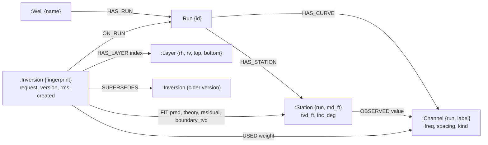

# Inversion results in a Neo4j graph store

## Goal

Store every inversion result in a Neo4j graph instead of only in backend memory.

- **Reuse:** a request that has already been computed is answered from the graph. Its stations (depth
  points) and observed values are stored only once and shared between inversions that overlap in
  depth.
- **Updates:** a request with the same inputs but newer inversion code adds a new version to the graph
  and links it to the old one.
- **Sharing:** the graph is exported to a portable file in the repo, so every developer can download
  the hackathon's inversion results and load them locally.
- **Persistence:** results survive a backend restart, so the 3D well tab's inversion layers no longer
  disappear.

## Current state (checked in code)

- The interface is `POST /inversion/jobs`, with fields `run`, `curves`, `md_min_ft`, `md_max_ft`,
  `step_ft`, `layers`, `calibration` and `quick`.
- Jobs run one at a time in a background thread and are kept in a process-wide dict
  (`backend/inversion/service.py`, `_jobs`).
- `GET /inversion/jobs?run=` lists finished jobs, and `GET /inversion/jobs/{id}/layers` returns the
  boundary geometry for the 3D tab.
- One job equals one MD interval, one layered model and up to 250 stations. The result
  (`service.serialize`) holds `md_ft`, `tvd_ft` and `inclination_deg` per station. For each channel
  it holds `obs`, `pred`, `theory`, `rms_percent` and `weight`. The model holds `layers[{rh, rv,
  top_tvd_ft, bottom_tvd_ft}]`, `dip_deg`, `dip_azimuth_deg` and `boundary_tvd_ft[boundary][station]`.
  It also holds `rms_percent_used`, `stations`, `forward_evaluations` and `elapsed_s`.
- Nothing is persisted. A backend restart clears all jobs.

## Graph model

- **Data points:**
  - `:Station`, unique on `(run, md_ft)` with `md_ft` rounded to 0.01 ft, is shared by every
    inversion that covers that depth.
  - `OBSERVED` holds the measured channel value once per station. It comes from the DLIS file, not
    from the inversion.
- **Results:** `:Inversion` holds the request, the plan (used channels and weights), the dip, the dip
  azimuth, the misfit summary, the timings, `INVERSION_VERSION` and `created`.
  - `HAS_LAYER` links it to the model's layers.
  - `FIT` links it to each station and carries `pred`, `theory`, `residual` per channel (as maps) and
    the `boundary_tvd_ft` list.
- **Constraints:** uniqueness on `Well.name`, `Run.id`, `(Station.run, Station.md_ft)`,
  `(Channel.run, Channel.label)` and `Inversion.fingerprint`, plus an index on `Inversion.run`.

## Store or update rules

The fingerprint is the sha256 of canonical JSON of the request: `run`, sorted `curves`, `md_min_ft`,
`md_max_ft`, `step_ft`, `layers`, `calibration` and `quick`, plus the plan's used labels and weights
and the `INVERSION_VERSION` constant.

| Situation on `POST /inversion/jobs` | Action |
|---|---|
| The fingerprint exists | Return the stored result immediately as a finished job with `"source": "graph"`. No computation. |
| Same request as an existing inversion, but older `INVERSION_VERSION` | Run it, store a new `:Inversion`, and add `(new)-[:SUPERSEDES]->(old)`. The old one stays for comparison and is hidden from default listings. |
| New request, with stations overlapping other inversions | Run it. `MERGE` the stations and observations (existing ones are reused, not duplicated), then create the `:Inversion` and its `FIT` edges. |
| A station's `OBSERVED` value differs from the stored value (data reloaded) | Update the value, set `updated_at`, and record it in the job message. |
| `force: true` in the request | Always run, and replace the `:Inversion` with the same fingerprint (`DETACH DELETE` the old one, then write). |

Each inversion is written in one transaction. A failed write leaves no half-written graph, and the
job is still reported as done, with a store warning.

## Out of Scope

- A Neo4j cluster, Aura cloud hosting, users and roles, or a production deployment.
- Storing raw DLIS curves (they stay in `data/*.dlis`). Only the stations and observed values used by
  an inversion are stored.
- Graph analytics, Neo4j Bloom or GDS, and a graph browser inside the app. Neo4j Browser is
  available at http://localhost:7474.
- Changing the inversion physics or the forward model.
- Storing QC selections in the graph. That's possible later; they stay as JSON files for now.

## Acceptance Criteria

1. **Run Neo4j:** `docker compose up -d neo4j` starts a pinned Neo4j 5 Community container. It has a
   named volume and a health check, and its credentials come from `.env`, with a committed
   `.env.example`. `SETUP.md` explains it for Mac and Windows.
2. **Backend configuration:** the backend reads `NEO4J_URI`, `NEO4J_USER` and `NEO4J_PASSWORD`, and
   no credentials are hard-coded. `GET /health` reports the store as `{"store": "neo4j"|"memory",
   "neo4j": "ok"|"unavailable"}`. It still returns 200 when Neo4j is down, and the backend then falls
   back to the in-memory store with a logged warning.
3. **Repeated requests:** submitting the same request twice computes once. The second call returns in
   under 1 s with `"source": "graph"` and the same result.
4. **Overlapping requests:** two inversions over overlapping MD intervals share their `:Station` and
   `OBSERVED` data. Counting stations in the graph gives the union of the stations, not the sum.
5. **Version bump:** raising `INVERSION_VERSION` and repeating a request creates a new `:Inversion`
   with `SUPERSEDES` to the old one. `GET /inversion/jobs?run=` lists only the newest.
6. **Survives restart:** after a backend restart, `GET /inversion/jobs?run=` and
   `/jobs/{id}/layers` still return the stored inversions, and the 3D well tab shows their layers.
7. **Sharing:**
   - `python -m backend.inversion.graph_io export` writes `data/graph/inversions.json`, a portable
     file that doesn't depend on the Neo4j version and stays under 50 MB.
   - `... import` loads it into an empty or existing database idempotently (`MERGE`).
   - The backend imports it automatically on startup when the database has no `:Inversion` nodes.
   - The file is committed to the repo.
8. **Tests:** they pass without Docker. Store logic runs against an in-memory implementation of the
   same interface, and a Neo4j integration test runs only when `NEO4J_URI` is set.

## Approach

- `backend/inversion/store.py` defines an `InversionStore` protocol with four methods:
  `find(fingerprint)`, `save(job)`, `list_finished(run)` and `get(job_id)`. There are two
  implementations:
  - `MemoryStore`: today's dict behaviour.
  - `Neo4jStore` (`backend/inversion/graph_store.py`): official `neo4j` Python driver, `MERGE`-based
    Cypher, one write transaction per inversion, and constraints created on startup.
- `service.submit` computes the fingerprint and asks the store first. It only runs the inversion when
  the store has no fresh match. `_execute` saves the result when the job finishes.
- Job ids are 12-character prefixes of the fingerprint instead of random uuids, so ids are stable
  across restarts and machines.
- `graph_io.py` exports to and imports from a JSON document: wells, runs, channels, stations,
  inversions with layers and fits. Export and import go through the same `save` path, so the import
  rules are the store rules.
- **Why a JSON export instead of committing the database:** the Neo4j data folder is binary, tied to
  the Neo4j version and holds file locks, and Git can't diff it. A `neo4j-admin database dump` file is
  smaller, but it is still version-bound and requires stopping the database. A JSON export works with
  any Neo4j 5, can be reviewed in a PR, and also loads into the memory store.

## Steps

0. **Prerequisite check:**
   - `docker --version` and `docker compose version` on the dev laptops.
   - If Docker isn't available, use Neo4j Desktop with the same `.env` values; document it in
     `SETUP.md`.
1. **Neo4j service:**
   - Files: `docker-compose.yml` (new, at the repo root), `.env.example` (add `NEO4J_*`), `.gitignore`
     (keep `.env`), `.gitattributes` (`*.yml eol=lf`).
   - The service:
     - Image: `neo4j:5.26-community`.
     - Ports 7474 and 7687.
     - Named volume `neo4j-data`.
     - `NEO4J_AUTH=${NEO4J_USER}/${NEO4J_PASSWORD}`.
     - A `cypher-shell` health check.
     - A memory limit.
   - Verify: `docker compose up -d neo4j`, then the health check reports healthy and
     http://localhost:7474 loads.
2. **Driver and configuration:**
   - Files: `backend/requirements.txt` (add `neo4j>=5.20`), `backend/inversion/store.py` (protocol,
     `MemoryStore`, factory from env), `backend/app.py` (`/health` store status).
   - Verify: `pytest backend/tests/test_inversion_store.py -q` (memory store) and `/health` with and
     without Neo4j running.
3. **Graph store:**
   - Files: `backend/inversion/graph_store.py` (constraints, `MERGE` writes, reads that rebuild the
     `serialize` result shape), `backend/tests/test_inversion_store.py` (the shared contract tests
     run against both stores; the Neo4j run is skipped without `NEO4J_URI`).
   - Verify: run the contract tests with `NEO4J_URI` set to the local container.
4. **Fingerprint and store-or-update in the service:**
   - Files: `backend/inversion/service.py` (fingerprint, `INVERSION_VERSION`, store lookup, `force`,
     save on finish), `backend/inversion/api.py` (`force` field, `source` in the job JSON, listing from
     the store).
   - Verify tests:
     - The same request twice computes once.
     - An overlapping interval reuses stations.
     - A version bump creates `SUPERSEDES`.
     - `force` replaces the stored inversion.
     - Use a stubbed `run_inversion` so the tests run in seconds.
5. **Export and import for sharing:**
   - Files: `backend/inversion/graph_io.py` (CLI `export` / `import`), auto-import on startup in
     `backend/app.py`, `data/graph/inversions.json` (seeded), `.gitignore` (allow `data/graph/`).
   - Verify:
     - Export, wipe the database (`MATCH (n) DETACH DELETE n`) and import; the node and edge counts
       must match.
     - Run the import twice; nothing may be duplicated.
6. **Seed the hackathon data:**
   - Run the reference inversions on the Inversion tab. These are the VC-2 interval used in the demo
     (17202–17322 ft) and the Z-20 calibration interval (20100–20500 ft).
   - Export them and commit `data/graph/inversions.json`.
   - Verify: on a clean clone, `docker compose up -d neo4j` plus starting the backend makes the 3D
     tab show the layers with no new inversion run.
7. **Docs:**
   - `SETUP.md`: Neo4j start, `.env` and the fallback.
   - `README.md`: storage section and sharing workflow (export → commit → pull → auto-import).
   - `docs/api/contract.md`: `force`, `source`, `/health` store fields.
   - This plan's implementation notes.
8. **Verification pass:**
   - Targeted pytest: store, inversion, `test_well3d.py`, `test_inversion_layers.py`.
   - `npm run lint` and `npm run build`, if the frontend shows `source`.
   - Headless check: run an inversion, restart the backend, and the 3D tab still shows the layers
     with no console errors.
9. **Ship:**
   - Branch `feature/inversion-graph-store` from `main`, conventional commits, push.
   - PR using the Why / What / How-to-test / Impact structure.
   - Merge after your approval, then restart the system.

## Validation Strategy

- **Unit (no Docker):**
  - Fingerprint stability (curve order, float formatting).
  - Store contract against `MemoryStore`: find, save, list newest, supersede, force.
  - Service flow with a stubbed inversion: cache hit, overlap reuse, version bump.
  - Export/import round trip through `MemoryStore`.
- **Integration (with `NEO4J_URI` set):**
  - The same contract tests against the real container.
  - The constraints exist.
  - An import twice gives identical counts.
- **Manual:**
  - Neo4j Browser: `MATCH (i:Inversion)-[:FIT]->(s:Station) RETURN i, s LIMIT 50` shows shared
    stations between overlapping inversions.
  - A cache hit is visible in the Inversion tab (instant done, "from graph").
  - The 3D layers survive a backend restart.
- **Not run locally:** the full UDAR suite (over 10 minutes).

## Integration Touchpoints

- `backend/inversion/service.py` and `api.py`: job creation, listing and layers. They keep the same
  JSON shape, so the Inversion tab and the 3D tab keep working, plus a new `source` field.
- The 3D well tab (`GET /inversion/jobs`, `/jobs/{id}/layers`): unchanged contract, now persistent.
- `GET /health`: new store fields, and still 200 when Neo4j is down.
- The repo: `docker-compose.yml`, `.env.example`, `data/graph/inversions.json`, `SETUP.md`.
- Teammates need Docker Desktop or Neo4j Desktop to get persistence. Without it, the backend works
  as it does today (in memory).

## Risks

| Risk | Likelihood | Impact | Mitigation |
|------|-----------|--------|------------|
| Docker isn't installed or allowed on a teammate's laptop | Medium | No persistence for them | Memory fallback, Neo4j Desktop instructions, and the JSON export also loads into the memory store |
| Shared JSON gets merge conflicts when two people export | Medium | Lost results | Export sorted and stable (by fingerprint), one exporter at a time; import is idempotent, so re-exporting after pulling resolves it |
| JSON grows too big for Git | Low | Slow clones | About 0.5 MB per inversion (250 stations × ~12 channels); warn when it passes 50 MB |
| Float noise breaks the fingerprint or station uniqueness | Medium | Duplicates | Round the MD to 0.01 ft, canonical JSON with fixed precision, plus a unit test |
| The cache returns stale results after a physics change | Medium | Wrong layers shown | Bump `INVERSION_VERSION` on any change to the inversion code (PR checklist line), plus `force` |
| A slow write blocks the job thread | Low | Delayed "done" | Batched `UNWIND` writes, one transaction per inversion |
| Default password committed | Low | Credential leak | Only `.env.example` with a placeholder; `.env` stays gitignored, and the local-only port binds to 127.0.0.1 |
| Neo4j Community licence (GPLv3) | Low | Licensing question | Used only as a separate local service; not bundled or modified |

## Rollback

- Set `NEO4J_URI` empty, or stop the container. The backend falls back to the in-memory store
  without code changes.
- Full rollback: revert the PR. `data/graph/inversions.json` and `docker-compose.yml` are additive,
  and nothing else reads them.
- `docker compose down -v` removes the local database volume.

## Decisions needed from you

1. **Sharing format:**
   - **A. JSON export `data/graph/inversions.json`, auto-imported** (recommended).
   - B. A `neo4j-admin` dump file (`.dump`, binary, tied to the Neo4j version).
   - C. The raw Neo4j data folder (not recommended: binary, locks, version-bound).
2. **How to run Neo4j:**
   - **A. Docker Compose** (recommended).
   - B. Neo4j Desktop.
   - C. Neo4j Aura Free in the cloud: one live shared database, no repo upload, but the data leaves
     the laptops.
3. **Detail stored per station:** **predicted, theory and residual per channel plus boundary TVD**
   (recommended; supports misfit plots later), or only the model and boundaries (smaller file).
4. **Cache hit behaviour:** return the stored result instantly, with a **Force re-run** option
   (recommended), or always re-run and only update the graph.
5. **Approval:** approve this plan, with any changes, to start implementation on
   `feature/inversion-graph-store`.
